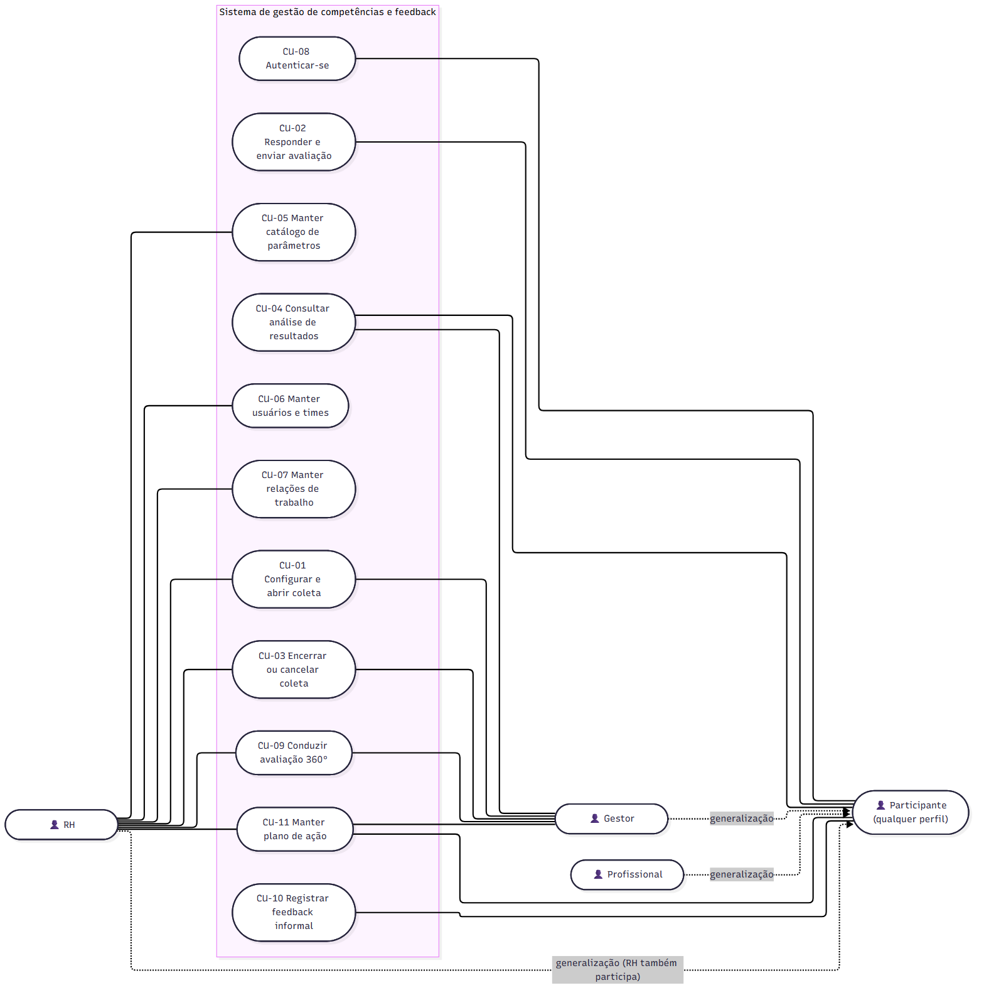

# Casos de uso

Modelo de casos de uso do sistema de gestão de competências e feedback, conforme o capítulo 6 de Larman (*Utilizando UML e padrões*). O diagrama é apenas um resumo visual; o conteúdo principal está nas descrições textuais.

## Diagrama

| Arquivo | Tipo |
| --- | --- |
| [diagrama-casos-de-uso.mmd](diagrama-casos-de-uso.mmd) | Fonte editável em Mermaid (usada na exportação) |
| [diagrama-casos-de-uso.puml](diagrama-casos-de-uso.puml) | Fonte editável em PlantUML, com a notação UML padrão de atores e elipses |
| [exportacoes/diagrama-casos-de-uso.png](exportacoes/diagrama-casos-de-uso.png) | Exportação |

O Mermaid não tem notação própria de casos de uso. Na exportação, atores aparecem com o ícone 👤, casos de uso como elipses e a fronteira do sistema como retângulo. A fonte PlantUML pode ser aberta em [plantuml.com](https://www.plantuml.com/plantuml) ou em extensão do VS Code.

## Atores

| Ator | Tipo | Objetivos |
| --- | --- | --- |
| Participante | Principal, abstrato | Responder às avaliações atribuídas, inclusive a autoavaliação, registrar feedbacks informais, registrar o progresso das ações de seus planos e consultar seus resultados. Generaliza RH, Gestor e Profissional, pois qualquer perfil pode avaliar e ser avaliado. |
| RH | Principal | Manter cadastros e catálogo, configurar, abrir, encerrar e cancelar coletas e acompanhar planos de ação em toda a organização. |
| Gestor | Principal | Configurar coletas e avaliações 360°, manter planos de ação e acompanhar os resultados dos times sob sua responsabilidade (RN14). |
| Profissional (PROF) | Principal | Participar das avaliações como avaliador e receptor. |

Avaliador e receptor são papéis circunstanciais em uma avaliação, não atores separados.

## Índice

Casos de uso **essenciais** descrevem a intenção do ator e a responsabilidade do sistema, sem depender da tecnologia da interface. A entrega prevê descrições completas dos cinco primeiros, uma por integrante, como pede a disciplina. Os arquivos já produzidos estão vinculados na tabela abaixo.

| ID | Caso de uso | Ator principal | Requisitos | Nível de descrição | Responsável | Arquivo |
| --- | --- | --- | --- | --- | --- | --- |
| CU-01 | Configurar e abrir coleta | RH, Gestor | RF08, RF09, RF10, RN03 a RN05, RN14 | Completo | Brenner Rodrigues Sardinha | [CU-01](CU-01-configurar-e-abrir-coleta.md) |
| CU-02 | Responder e enviar avaliação | Participante | RF11, RF12, RF22, RN06, RN08, RN09 | Completo | Luiz Augusto Vaz | [CU-02](CU-02-responder-e-enviar-avaliacao.md) |
| CU-03 | Encerrar ou cancelar coleta | RH, Gestor | RF13, RF16, RN01, RN07 a RN09, RN12 | Completo | Heitor Barbosa Souza | [CU-03](CU-03-encerrar-ou-cancelar-coleta.md) |
| CU-04 | Consultar análise de resultados | Participante, Gestor | RF14, RF15, RN09 a RN11 | Completo | Enzo de Oliveira Machado | [CU-04](CU-04-consultar-analise-de-resultados.md) |
| CU-05 | Manter catálogo de parâmetros | RH | RF05, RF06, RF07, RN04 | Completo | Danilo Sucupira Galvão | [CU-05](CU-05-manter-catalogo-de-parametros.md) |
| CU-06 | Manter usuários e times | RH | RF02, RF03 | Resumido | — | Abaixo |
| CU-07 | Manter relações de trabalho | RH | RF04 | Resumido | — | Abaixo |
| CU-08 | Autenticar-se | Participante | RF01, RNF09 | Resumido | — | Abaixo |
| CU-09 | Conduzir avaliação 360° | RH, Gestor | RF17, RF22, RN14, RN15 | Resumido | — | Abaixo |
| CU-10 | Registrar feedback informal | Participante | RF19, RF20, RF21, RN16 | Resumido | — | Abaixo |
| CU-11 | Manter plano de ação | Gestor, RH, Participante | RF18, RN13, RN14 | Resumido | — | Abaixo |

CU-01 a CU-05 têm autoria registrada nos respectivos documentos. O CU-01 foi descrito por Brenner na issue #14, e o CU-04 é a entrega de Enzo para a issue #16.

## Relacionamentos

- **Generalização de atores:** RH, Gestor e Profissional herdam os casos de uso do Participante.
- **Inclusão e extensão:** não foram usadas. Larman recomenda evitar `<<include>>` e `<<extend>>` quando não há reuso real. A autenticação (CU-08) é tratada como pré-condição dos demais.
- **Dependência de dados:** CU-02 só pode ocorrer depois de CU-01 ou CU-09, que geram as avaliações; CU-04 depende de CU-03, que libera os resultados; CU-11 parte de um feedback recebido em CU-02 ou CU-10.
- **Autoavaliação:** é respondida pelo CU-02, com avaliador igual ao receptor (RF22). Não exige caso de uso próprio.

## Casos de uso resumidos

**CU-06 Manter usuários e times.** O RH cadastra, consulta, altera e desativa usuários e times, informando nome, cargo, time, perfil e e-mail dos usuários, e nome, setor e gestor dos times. O sistema valida unicidade de e-mail e perfil do gestor, e nunca exclui fisicamente.

**CU-07 Manter relações de trabalho.** O RH vincula e desvincula dois usuários que trabalham juntos. O sistema impede autorrelação e trata A–B e B–A como o mesmo vínculo.

**CU-08 Autenticar-se.** O participante informa suas credenciais; o sistema autentica contas ativas, identifica o perfil e aplica as permissões em cada operação.

**CU-09 Conduzir avaliação 360°.** O RH ou o gestor, dentro do seu escopo, cria uma coleta 360°, escolhe o questionário, seleciona os avaliados e, para cada um, os participantes por papel: gestor, colegas, subordinados e o próprio avaliado. O sistema sugere participantes pelos vínculos de gestão e de trabalho, mostra a prévia e, na abertura, gera uma avaliação por participante, com o papel registrado e sem reciprocidade. As respostas seguem o CU-02 e o encerramento segue o CU-03.

**CU-10 Registrar feedback informal.** O participante escolhe o receptor, descreve o fato motivador e os impactos, classifica o feedback como positivo ou construtivo e escreve o conteúdo. O sistema registra o feedback como informal, sem abrir coleta, e o disponibiliza ao receptor após o envio.

**CU-11 Manter plano de ação.** A partir de um feedback recebido pelo colaborador, o gestor ou o RH cria um plano com metas, ações, responsáveis, prazos e pontos de verificação, definidos com o colaborador. O colaborador registra o progresso das ações atribuídas; o responsável registra as verificações, ajusta o plano e vincula o feedback seguinte que avalia os resultados. O plano é concluído ou cancelado com motivo, nunca excluído.
