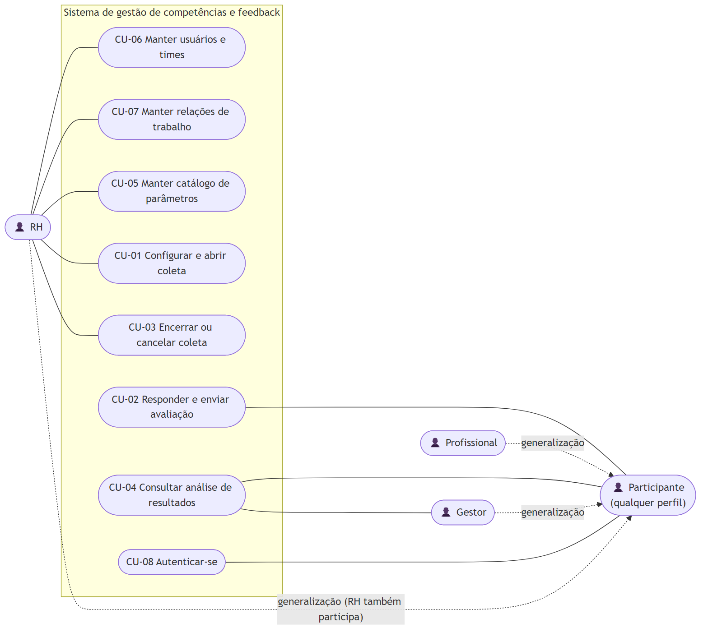

# Casos de uso

Modelo de casos de uso do sistema de gestão de competências e feedback, conforme o capítulo 6 de Larman (*Utilizando UML e padrões*). O diagrama é apenas um resumo visual; o conteúdo principal está nas descrições textuais.

## Diagrama

| Arquivo | Tipo |
| --- | --- |
| [diagrama-casos-de-uso.mmd](diagrama-casos-de-uso.mmd) | Fonte editável em Mermaid (usada na exportação) |
| [diagrama-casos-de-uso.puml](diagrama-casos-de-uso.puml) | Fonte editável em PlantUML, com a notação UML padrão de atores e elipses |
| [exportacoes/diagrama-casos-de-uso.png](exportacoes/diagrama-casos-de-uso.png) | Exportação |

O Mermaid não tem notação própria de casos de uso. Na exportação, atores aparecem com o ícone 👤, casos de uso como elipses e a fronteira do sistema como retângulo. A fonte PlantUML pode ser aberta em [plantuml.com](https://www.plantuml.com/plantuml) ou em extensão do VS Code.

## Atores

| Ator | Tipo | Objetivos |
| --- | --- | --- |
| Participante | Principal, abstrato | Responder às avaliações atribuídas e consultar seus resultados. Generaliza RH, Gestor e Profissional, pois qualquer perfil pode avaliar e ser avaliado. |
| RH | Principal | Manter cadastros e catálogo, configurar, abrir, encerrar e cancelar coletas. |
| Gestor | Principal | Acompanhar os resultados dos times sob sua responsabilidade. |
| Profissional (PROF) | Principal | Participar das avaliações como avaliador e receptor. |

Avaliador e receptor são papéis circunstanciais em uma avaliação, não atores separados.

## Índice

Casos de uso **essenciais** descrevem a intenção do ator e a responsabilidade do sistema, sem depender da tecnologia da interface. Os cinco primeiros são descritos de forma completa, um por integrante, como pede a disciplina.

| ID | Caso de uso | Ator principal | Requisitos | Nível de descrição | Responsável | Arquivo |
| --- | --- | --- | --- | --- | --- | --- |
| CU-01 | Configurar e abrir coleta | RH | RF08, RF09, RF10, RN03 a RN05 | Completo | Brenner (proposta) | A elaborar |
| CU-02 | Responder e enviar avaliação | Participante | RF11, RF12, RN06, RN08, RN09 | Completo | Luiz Augusto Vaz | [CU-02](CU-02-responder-e-enviar-avaliacao.md) |
| CU-03 | Encerrar ou cancelar coleta | RH | RF13, RN01, RN07 | Completo | Heitor (proposta) | A elaborar |
| CU-04 | Consultar análise de resultados | Participante, Gestor | RF14, RF15, RN09 a RN11 | Completo | Enzo (proposta) | A elaborar |
| CU-05 | Manter catálogo de parâmetros | RH | RF05, RF06, RF07, RN04 | Completo | Danilo (proposta) | A elaborar |
| CU-06 | Manter usuários e times | RH | RF02, RF03 | Resumido | — | Abaixo |
| CU-07 | Manter relações de trabalho | RH | RF04 | Resumido | — | Abaixo |
| CU-08 | Autenticar-se | Participante | RF01, RNF09 | Resumido | — | Abaixo |

A distribuição de CU-01, CU-03, CU-04 e CU-05 é uma **proposta** para evitar sobreposição entre as issues #14 a #17. Cada integrante deve confirmar ou trocar seu caso na própria issue.

## Relacionamentos

- **Generalização de atores:** RH, Gestor e Profissional herdam os casos de uso do Participante.
- **Inclusão e extensão:** não foram usadas. Larman recomenda evitar `<<include>>` e `<<extend>>` quando não há reuso real. A autenticação (CU-08) é tratada como pré-condição dos demais.
- **Dependência de dados:** CU-02 só pode ocorrer depois de CU-01, que gera as avaliações; CU-04 depende de CU-03, que libera os resultados.

## Casos de uso resumidos

**CU-06 Manter usuários e times.** O RH cadastra, consulta, altera e desativa usuários e times, informando nome, cargo, time, perfil e e-mail dos usuários, e nome, setor e gestor dos times. O sistema valida unicidade de e-mail e perfil do gestor, e nunca exclui fisicamente.

**CU-07 Manter relações de trabalho.** O RH vincula e desvincula dois usuários que trabalham juntos. O sistema impede autorrelação e trata A–B e B–A como o mesmo vínculo.

**CU-08 Autenticar-se.** O participante informa suas credenciais; o sistema autentica contas ativas, identifica o perfil e aplica as permissões em cada operação.
