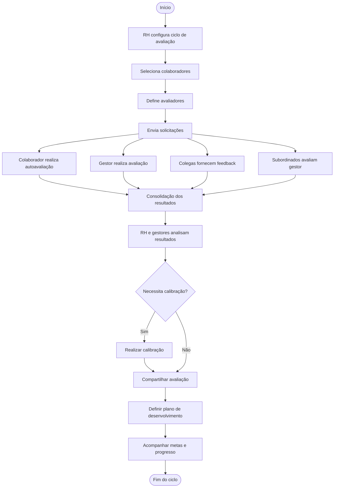

# Análise do Culture Amp — Sistema Análogo para o Projeto de Gestão de Competências

## 1. Objetivo da análise

Este documento apresenta uma análise do **Culture Amp** como sistema análogo para o projeto acadêmico de Gestão de Competências, cujo escopo envolve diferentes modalidades de feedback, avaliações por múltiplas fontes, questionários, análise de resultados, confidencialidade, histórico e planos de desenvolvimento.

O objetivo não é reproduzir integralmente a plataforma, mas identificar funcionalidades, processos, regras de negócio e características de qualidade que possam orientar o levantamento de requisitos e o desenvolvimento do sistema acadêmico.

## 2. Caracterização geral

O [Culture Amp](https://www.cultureamp.com/) é uma plataforma SaaS (*Software as a Service*) de gestão de pessoas, desempenho, desenvolvimento profissional e engajamento de colaboradores.

A plataforma integra processos de Recursos Humanos e permite que organizações coletem avaliações, registrem feedbacks, acompanhem metas e utilizem dados para apoiar decisões relacionadas ao desenvolvimento dos colaboradores.

### 2.1 Principais áreas da plataforma

| Área | Finalidade | Relação com o projeto |
| --- | --- | --- |
| Engage | Pesquisas de engajamento, clima e experiência dos colaboradores | Complementar |
| Perform | Avaliações de desempenho, feedback, metas e calibração | Essencial |
| Develop | Desenvolvimento profissional, competências e evolução | Essencial |

A nomenclatura e a composição dos produtos podem variar conforme a oferta comercial vigente.

### 2.2 Público-alvo

- Empresas de diferentes portes.
- Departamentos de Recursos Humanos.
- Gestores e líderes de equipes.
- Profissionais responsáveis pelo desenvolvimento de talentos.
- Colaboradores que participam de avaliações de desempenho.

### 2.3 Problemas organizacionais abordados

| Problema | Solução oferecida pela plataforma |
| --- | --- |
| Avaliações subjetivas | Questionários e critérios estruturados |
| Falta de comunicação | Feedback contínuo |
| Visão limitada do desempenho | Avaliações de múltiplas fontes |
| Ausência de acompanhamento | Metas e planos de desenvolvimento |
| Falta de histórico | Registros de ciclos e avaliações |
| Dificuldade de analisar resultados | Relatórios e recursos analíticos |
| Baixo engajamento | Pesquisas e indicadores organizacionais |

## 3. Levantamento das funcionalidades

### 3.1 Avaliação de desempenho (*Performance Reviews*)

A plataforma permite organizar ciclos de avaliação nos quais colaboradores, gestores e colegas participam de um processo estruturado. Os ciclos podem ser configurados de acordo com as necessidades da organização, por exemplo, trimestral, semestral ou anualmente.

Principais funcionalidades:

1. Criação e configuração de ciclos de avaliação.
2. Definição de datas de início e encerramento.
3. Seleção dos colaboradores participantes.
4. Configuração dos formulários e perguntas.
5. Definição dos avaliadores.
6. Realização de autoavaliações.
7. Avaliação por gestores.
8. Feedback entre colegas.
9. Feedback ascendente, quando configurado.
10. Consolidação dos resultados.
11. Compartilhamento das avaliações.
12. Acompanhamento do status das avaliações.

A organização pode configurar quais modalidades de avaliação serão utilizadas em cada ciclo.

### 3.2 Feedback 360°

O feedback 360° reúne diferentes perspectivas sobre o desempenho de um colaborador. Em vez de depender apenas da avaliação do gestor, o processo pode considerar opiniões de pessoas que trabalham com o avaliado.

| Modalidade | Descrição | Exemplo |
| --- | --- | --- |
| Autoavaliação | O colaborador avalia o próprio desempenho | Identificar pontos fortes e dificuldades |
| Gestor | O superior avalia o colaborador | Avaliar cumprimento de metas |
| Pares | Colegas avaliam o colaborador | Avaliar colaboração e comunicação |
| Subordinados | Colaboradores avaliam seus gestores | Avaliar liderança e relacionamento |

Fluxo geral:

1. O administrador configura um ciclo.
2. São selecionados os colaboradores participantes.
3. São definidos ou indicados os avaliadores, conforme as regras do ciclo.
4. O sistema envia solicitações de avaliação.
5. Os avaliadores respondem aos questionários.
6. O colaborador realiza sua autoavaliação, quando prevista.
7. O gestor realiza sua avaliação.
8. As respostas são consolidadas.
9. Os resultados podem passar por calibração.
10. A avaliação é compartilhada conforme as permissões e regras de confidencialidade.

**Relação com o projeto:** atende ao requisito de reunir visões de gestores, colegas e outras fontes para produzir uma avaliação mais abrangente.

### 3.3 Feedback contínuo (*Continuous Feedback*)

Além dos ciclos formais, a plataforma oferece mecanismos para registrar e solicitar feedback ao longo da rotina de trabalho.

Possibilidades incluem:

- Envio de feedback a qualquer momento.
- Solicitação de feedback a colegas.
- Feedback entre integrantes da equipe.
- Registro de elogios e reconhecimentos.
- Compartilhamento de observações construtivas.
- Acompanhamento do feedback recebido.

Essa abordagem permite que o feedback não fique restrito às avaliações semestrais ou anuais.

| Tipo previsto na atividade | Aplicação possível |
| --- | --- |
| Formal | Avaliações organizadas em ciclos |
| Informal | Feedback contínuo |
| Positivo | Reconhecimento de comportamentos e resultados |
| Construtivo | Identificação de oportunidades de melhoria |

A classificação formal/informal e positivo/construtivo é uma interpretação dos usos possíveis, não necessariamente quatro categorias obrigatórias e independentes na interface da plataforma.

### 3.4 Questionários e formulários de avaliação

Os questionários padronizam a coleta de informações sobre o desempenho e as competências dos colaboradores. As perguntas podem orientar os avaliadores na análise de comportamentos, resultados e habilidades.

Dimensões que podem ser avaliadas:

- Comunicação.
- Trabalho em equipe.
- Liderança.
- Organização.
- Proatividade.
- Resolução de problemas.
- Conhecimento técnico.
- Cumprimento de objetivos.

Exemplos de perguntas que poderiam ser utilizadas em um sistema acadêmico:

| Pergunta | Tipo de resposta sugerido |
| --- | --- |
| O colaborador demonstra boa comunicação? | Escala de 1 a 5 |
| Cumpre os prazos estabelecidos? | Escala de 1 a 5 |
| Colabora com os demais integrantes da equipe? | Escala de 1 a 5 |
| Quais são seus principais pontos fortes? | Texto livre |
| Quais competências precisam melhorar? | Texto livre |
| Que recomendação você daria para o desenvolvimento desse colaborador? | Texto livre |

Essas perguntas são exemplos elaborados para o projeto, não uma reprodução dos formulários proprietários da Culture Amp.

### 3.5 Gestão de metas (*Goal Management*)

A plataforma oferece recursos para definir e acompanhar metas em diferentes níveis da organização, relacionando objetivos individuais aos objetivos de equipes e da empresa.

Exemplo acadêmico:

- Meta: melhorar a comunicação profissional.
- Indicador: avaliação média da competência comunicação.
- Valor inicial: 2,5.
- Objetivo: atingir 4,0.
- Prazo: seis meses.
- Acompanhamento: avaliações periódicas.

O exemplo ilustra como o feedback pode ser convertido em objetivos mensuráveis.

### 3.6 Desenvolvimento profissional e planos de ação

Os recursos de desenvolvimento permitem relacionar os resultados das avaliações a ações de melhoria.

Possibilidades:

- Identificar competências que precisam ser desenvolvidas.
- Estabelecer objetivos profissionais.
- Planejar ações de desenvolvimento.
- Registrar compromissos.
- Acompanhar a evolução.
- Apoiar conversas entre gestores e colaboradores.

Exemplo: um colaborador recebe avaliações que apontam uma oportunidade de melhoria em liderança. O gestor e o colaborador podem estabelecer ações como participar de treinamento, conduzir reuniões, receber acompanhamento e realizar uma nova avaliação após determinado período.

### 3.7 Reuniões individuais (*1-on-1*)

A plataforma oferece recursos para organizar conversas individuais entre gestores e colaboradores.

Essas reuniões podem ser utilizadas para:

- Discutir resultados das avaliações.
- Conversar sobre dificuldades.
- Acompanhar metas.
- Definir prioridades.
- Discutir oportunidades de crescimento.
- Registrar assuntos importantes.

O objetivo é conectar o feedback registrado no sistema a conversas e ações concretas.

### 3.8 Reconhecimento (*Shoutouts*)

O recurso Shoutouts permite reconhecer contribuições e comportamentos positivos dos colaboradores.

Exemplos:

- Reconhecimento por colaboração.
- Destaque por cumprimento de metas.
- Reconhecimento por iniciativa.
- Agradecimento pela ajuda prestada à equipe.

Esse recurso está relacionado ao feedback positivo e pode contribuir para o engajamento.

### 3.9 Análises e relatórios de desempenho

A plataforma oferece recursos para transformar os feedbacks coletados em informações úteis para gestores e RH.

Entre as possibilidades documentadas estão:

- Acompanhamento do andamento dos ciclos.
- Quantidade de avaliações solicitadas e concluídas.
- Visualização de resultados.
- Consulta ao histórico de desempenho.
- Análise de feedbacks recebidos.
- Comparação entre ciclos.
- Identificação de pontos fortes e oportunidades de melhoria.
- Visualizações para calibração.

A Culture Amp também documenta recursos de inteligência artificial que podem resumir destaques e oportunidades a partir de fontes de feedback, quando disponíveis e habilitados.

### 3.10 Calibração das avaliações

A calibração busca reduzir diferenças injustificadas na maneira como gestores avaliam colaboradores.

Exemplo: um gestor atribui notas muito altas para quase toda a equipe, enquanto outro atribui notas baixas mesmo para desempenhos semelhantes. A calibração permite analisar avaliações em conjunto e discutir critérios antes da divulgação dos resultados.

A plataforma oferece recursos de visualização e análise para apoiar esse processo. A calibração não elimina automaticamente a subjetividade: depende de critérios organizacionais e da análise dos responsáveis.

### 3.11 Pesquisas de engajamento e experiência

O módulo Engage contempla pesquisas relacionadas à experiência dos colaboradores, como:

- Satisfação no trabalho.
- Engajamento.
- Clima organizacional.
- Inclusão.
- Bem-estar.
- Experiência de integração.
- Experiência de desligamento.
- Percepção sobre liderança.

Essas pesquisas são complementares ao escopo acadêmico. Não é necessário implementar todo o módulo de engajamento para atender à proposta da disciplina.

### 3.12 Administração e acompanhamento

A plataforma oferece recursos administrativos, como:

- Gerenciamento de colaboradores.
- Configuração de ciclos.
- Definição de participantes.
- Gerenciamento de permissões.
- Acompanhamento de pendências.
- Configuração de prazos.
- Integrações com sistemas de RH.
- Controle de acesso às informações.

## 4. Confidencialidade, anonimato e proteção de dados

A confidencialidade é importante porque os colaboradores precisam sentir segurança para fornecer avaliações honestas, inclusive sobre seus superiores.

### 4.1 Diferença entre anonimato e confidencialidade

- **Anonimato:** a identidade do avaliador não é apresentada junto à resposta.
- **Confidencialidade:** as informações são protegidas e somente pessoas autorizadas podem acessá-las.

A Culture Amp oferece mecanismos de controle de acesso e regras de confidencialidade. Entretanto, o anonimato não é absoluto em todas as situações.

Por exemplo, se apenas uma pessoa responder à avaliação de um gestor, o gestor poderá deduzir quem forneceu a resposta, mesmo que o nome não seja exibido.

Para o sistema acadêmico, recomenda-se:

1. Não apresentar o nome do avaliador ao avaliado quando o feedback for configurado como anônimo.
2. Permitir consulta aos resultados somente por usuários autorizados.
3. Impedir a divulgação de resultados de grupos com quantidade insuficiente de respostas.
4. Registrar e auditar acessos administrativos.
5. Exibir resultados consolidados respeitando as regras de confidencialidade.
6. Alertar quando a quantidade de respostas puder comprometer o anonimato.

Como regra de projeto, o grupo poderia estabelecer um mínimo de três respostas por grupo de avaliadores para liberar resultados agregados. Esse número seria uma decisão do grupo, não uma regra universal da Culture Amp.

### 4.2 Controle de acesso

Os papéis e permissões podem variar conforme o produto e a configuração. Para fins de análise, podem ser identificados os seguintes perfis:

| Perfil | Responsabilidade |
| --- | --- |
| Administrador da conta | Gerenciamento geral da plataforma |
| Administrador de desempenho | Configuração dos ciclos de avaliação |
| RH / HRBP | Acompanhamento de colaboradores e avaliações conforme permissões |
| Gestor | Avaliação e acompanhamento de subordinados |
| Colaborador | Participação nas avaliações e acompanhamento do desenvolvimento |
| Avaliador | Responder solicitações de feedback |

### 4.3 LGPD — Lei Geral de Proteção de Dados

A legislação brasileira aplicável é a Lei nº 13.709/2018. Como o projeto envolve informações sobre desempenho, comportamento e opiniões de colaboradores, é necessário considerar a proteção de dados pessoais desde a concepção do sistema.

Aspectos a investigar e contemplar:

- Definição das finalidades de tratamento.
- Identificação dos papéis de controlador e operador.
- Transparência sobre a coleta e utilização dos dados.
- Controle de acesso.
- Proteção das informações confidenciais.
- Registro de operações relevantes.
- Regras de retenção e descarte.
- Atendimento aos direitos dos titulares.
- Proteção dos dados durante transmissão e armazenamento.
- Avaliação de transferências internacionais, quando aplicável.

A Culture Amp disponibiliza documentação contratual de tratamento de dados (*Data Processing Addendum*). Isso não deve ser interpretado como comprovação automática de conformidade integral com a LGPD. A adequação depende do contexto de uso, dos contratos, das configurações e das operações de tratamento.

### 4.4 Requisitos LGPD propostos

| ID | Requisito proposto | Justificativa |
| --- | --- | --- |
| RNF-LGPD-01 | O sistema deverá informar a finalidade da coleta de dados. | Transparência |
| RNF-LGPD-02 | O sistema deverá permitir acesso somente a usuários autorizados. | Segurança |
| RNF-LGPD-03 | O sistema deverá proteger informações confidenciais. | Privacidade |
| RNF-LGPD-04 | O sistema deverá registrar operações relevantes de acesso e alteração. | Auditoria |
| RNF-LGPD-05 | O sistema deverá permitir atender solicitações dos titulares conforme a legislação. | Direitos dos titulares |
| RNF-LGPD-06 | O sistema deverá limitar a coleta aos dados necessários para sua finalidade. | Necessidade |
| RNF-LGPD-07 | O sistema deverá estabelecer regras de retenção e descarte de dados. | Ciclo de vida dos dados |
| RNF-LGPD-08 | O sistema deverá proteger os dados durante transmissão e armazenamento. | Segurança |

Esses requisitos são propostas para o sistema acadêmico, não afirmações de que todos estejam disponíveis exatamente da mesma maneira na Culture Amp.

## 5. Segurança e aspectos técnicos

A Culture Amp é comercializada como serviço SaaS. A empresa documenta medidas técnicas e organizacionais de segurança, incluindo controles de acesso, criptografia e práticas de segurança empresarial.

Entre os aspectos a investigar na documentação oficial estão:

- Certificações e auditorias de segurança, como ISO/IEC 27001 e SOC 2 Type II.
- Criptografia de dados em trânsito e em repouso.
- Autenticação e autorização.
- Single Sign-On (SSO).
- Integrações com provedores de identidade.
- Hospedagem e infraestrutura em nuvem.
- Gestão de permissões.
- Procedimentos de proteção e tratamento de dados.

A empresa também documenta integrações com ferramentas corporativas e sistemas de RH, incluindo opções de integração por API, SFTP e provedores de identidade. A disponibilidade de cada integração depende do contrato e da configuração.

### 5.1 Plataforma web e dispositivos móveis

A plataforma é acessível pela web e possui integrações com ferramentas utilizadas em dispositivos móveis, como Teams e Slack. A disponibilidade de cada funcionalidade em aplicativos ou interfaces móveis deve ser verificada individualmente.

Para o projeto acadêmico, recomenda-se uma aplicação web responsiva, preparada para diferentes tamanhos de tela e com possibilidade de evolução para dispositivos móveis.

## 6. Planos de pagamento e modelo comercial

O Culture Amp utiliza um modelo comercial empresarial, com contratação SaaS e preços personalizados.

O preço depende de fatores como:

1. Quantidade de colaboradores.
2. Produtos contratados.
3. Nível de serviço.
4. Necessidades de implementação e suporte.

A contratação é apresentada em modelo anual e a empresa solicita contato comercial para elaborar uma proposta. Não há valores públicos suficientemente detalhados para informar um preço confiável em reais ou dólares.

### 6.1 Produtos

| Produto | Funcionalidades principais | Relação com o projeto |
| --- | --- | --- |
| Engage | Pesquisas, engajamento, clima e análise de comentários | Complementar |
| Perform | Avaliações, feedback, metas e calibração | Essencial |
| Develop | Desenvolvimento profissional e competências | Essencial |

A oferta comercial também pode contemplar serviços especializados de consultoria em gestão de pessoas.

### 6.2 Condições comerciais

| Informação | Condição |
| --- | --- |
| Modalidade | SaaS |
| Cobrança | Anual |
| Valor por colaborador | Depende da proposta |
| Contratação | Mediante contato comercial |
| Produtos | Variam conforme a contratação |
| Suporte | Conforme o plano e a oferta comercial |
| Implementação | Varia conforme o porte e os serviços contratados |

**Conclusão sobre preços:** no relatório acadêmico, deve-se registrar que o Culture Amp trabalha com preços personalizados, contratados anualmente e calculados conforme o porte da empresa e os módulos escolhidos. Não se devem inventar valores ou faixas de preço.

Página oficial: <https://www.cultureamp.com/platform/plans-and-pricing>

## 7. Atores e casos de uso relacionados ao projeto

Os casos de uso a seguir são reconstruções conceituais baseadas nas funcionalidades documentadas e servem como referência para o sistema acadêmico.

### 7.1 Atores

| Ator | Responsabilidade |
| --- | --- |
| Administrador / RH | Configurar o sistema, cadastrar participantes, gerenciar ciclos e acompanhar avaliações |
| Gestor | Avaliar colaboradores, acompanhar resultados e orientar o desenvolvimento |
| Colaborador | Realizar autoavaliação, receber feedback e acompanhar metas |
| Avaliador / Colega | Fornecer feedback sobre outros colaboradores |
| RH / Comitê de calibração | Analisar avaliações consolidadas e apoiar a padronização dos resultados |

### 7.2 Lista de casos de uso

| ID | Caso de uso | Ator principal |
| --- | --- | --- |
| UC01 | Autenticar usuário | Todos |
| UC02 | Gerenciar colaboradores | Administrador |
| UC03 | Configurar ciclo de avaliação | Administrador |
| UC04 | Definir avaliadores | Administrador / Gestor |
| UC05 | Realizar autoavaliação | Colaborador |
| UC06 | Avaliar colaborador | Gestor |
| UC07 | Fornecer feedback a um colega | Avaliador |
| UC08 | Fornecer feedback ao gestor | Colaborador |
| UC09 | Solicitar feedback | Gestor / Colaborador |
| UC10 | Consultar feedback recebido | Colaborador |
| UC11 | Consolidar resultados | Sistema |
| UC12 | Calibrar avaliações | RH / Gestor |
| UC13 | Compartilhar resultado | Gestor |
| UC14 | Registrar feedback contínuo | Usuários autorizados |
| UC15 | Definir metas de desenvolvimento | Gestor / Colaborador |
| UC16 | Acompanhar plano de desenvolvimento | Gestor / Colaborador |
| UC17 | Consultar histórico de avaliações | Usuários autorizados |
| UC18 | Gerar relatórios | RH / Administrador |
| UC19 | Gerenciar permissões | Administrador |

### 7.3 Caso de uso completo — UC07: Fornecer feedback a um colega

| Campo | Descrição |
| --- | --- |
| Ator principal | Avaliador / Colega |
| Objetivo | Registrar uma avaliação sobre o desempenho de outro colaborador |
| Pré-condição | Avaliador autenticado e autorizado a responder à solicitação |
| Pós-condição | Feedback registrado e associado ao ciclo de avaliação |

**Fluxo principal:**

1. O avaliador acessa o sistema.
2. O sistema apresenta suas tarefas pendentes.
3. O avaliador seleciona uma solicitação de feedback.
4. O sistema apresenta o questionário.
5. O avaliador responde às perguntas.
6. O avaliador registra comentários e exemplos.
7. O avaliador revisa suas respostas.
8. O avaliador envia o formulário.
9. O sistema valida as informações.
10. O sistema registra o feedback.
11. O sistema atualiza o status da solicitação.

**Fluxos alternativos:**

- 5a. O avaliador deixa uma questão obrigatória sem resposta. O sistema informa a pendência.
- 8a. O avaliador decide salvar o formulário sem enviá-lo, caso esse recurso esteja habilitado.
- 9a. O ciclo está encerrado. O sistema impede o envio.
- 10a. Ocorre uma falha de comunicação. O sistema informa que o envio não foi confirmado e preserva o conteúdo, quando possível.

**Regras de negócio propostas:**

- RN01: somente avaliadores autorizados podem responder à solicitação.
- RN02: o feedback deve pertencer a um ciclo ou solicitação válida.
- RN03: as respostas devem respeitar as regras de confidencialidade.
- RN04: o sistema deve registrar a data e o status do envio.
- RN05: um feedback enviado não deve ser alterado sem regra explícita de correção e auditoria.

## 8. Processo de negócio — avaliação 360°

O processo abaixo é uma proposta de modelagem para o projeto, baseada no fluxo geral de avaliação da plataforma.

O processo demonstra que a avaliação envolve diferentes participantes, consolidação de respostas, possível calibração, compartilhamento dos resultados e acompanhamento de ações de desenvolvimento.

Essa representação pode ser convertida para BPMN 2.0 em ferramentas como Bizagi Modeler ou Camunda Modeler. O diagrama acima é um fluxograma conceitual, não uma representação BPMN formal.

## 9. Comparação com os requisitos da atividade

| Requisito da atividade | Funcionalidade análoga | Atendimento |
| --- | --- | --- |
| Feedback chefe-colaborador | Manager Reviews | Sim |
| Feedback entre pares | Peer Feedback | Sim |
| Feedback 360° | Ciclos de avaliação com múltiplas fontes | Sim |
| Feedback formal | Performance Reviews | Sim |
| Feedback informal | Continuous Feedback | Sim |
| Feedback positivo | Shoutouts e reconhecimento | Sim |
| Feedback construtivo | Feedback e sugestões de melhoria | Sim |
| Questionários | Formulários de avaliação | Sim |
| Múltiplas fontes | Gestores, pares, subordinados e autoavaliação | Sim |
| Análises e indicadores | Relatórios e recursos analíticos | Sim |
| Anonimato | Regras de confidencialidade configuráveis | Parcial; depende da configuração e do número de respostas |
| Histórico | Histórico de ciclos e avaliações | Sim |
| Planos de desenvolvimento | Recursos de desenvolvimento profissional | Sim |
| Acompanhamento de metas | Goal Management | Sim |
| Plataforma web | Plataforma SaaS | Sim |
| Dispositivos móveis | Acesso web e integrações móveis | Deve ser validado por funcionalidade |
| LGPD | Recursos de privacidade e segurança; adequação brasileira depende do contexto | Exige validação |

A tabela representa a correspondência entre funcionalidades documentadas e objetivos da atividade. Não é resultado de auditoria independente da plataforma.

## 10. Pontos fortes, limitações e oportunidades

### 10.1 Pontos fortes

- Integra diferentes modalidades de feedback.
- Permite avaliações em ciclos configuráveis.
- Relaciona feedback, metas e desenvolvimento.
- Oferece recursos de análise e calibração.
- Possui controles de permissões.
- Disponibiliza documentação de suporte.
- Oferece recursos de inteligência artificial em determinadas funcionalidades.

### 10.2 Limitações e pontos de atenção

- Preços não transparentes e personalizados.
- Modelo comercial voltado principalmente a organizações.
- Anonimato sujeito ao tamanho e à composição dos grupos.
- Grande quantidade de funcionalidades pode aumentar a complexidade.
- Dependência de conectividade por ser SaaS.
- Necessidade de avaliar a adequação à LGPD e eventuais transferências internacionais.

## 11. Requisitos de qualidade — ISO/IEC 25010

A análise do Culture Amp pode orientar a definição dos requisitos não funcionais do projeto.

| Característica de qualidade | Requisito proposto |
| --- | --- |
| Adequação funcional | O sistema deverá oferecer mecanismos para registrar e consultar diferentes tipos de feedback. |
| Eficiência de desempenho | O sistema deverá apresentar resultados das avaliações sem atrasos perceptíveis em condições normais de uso. |
| Compatibilidade | O sistema deverá permitir integração futura com ferramentas externas. |
| Usabilidade | A interface deverá facilitar o preenchimento dos questionários e a consulta aos resultados. |
| Confiabilidade | O sistema deverá preservar os feedbacks registrados, evitando perda de informações. |
| Segurança | O sistema deverá implementar autenticação, autorização e proteção dos dados. |
| Manutenibilidade | O sistema deverá permitir a evolução dos questionários e regras de avaliação sem grandes alterações estruturais. |
| Portabilidade | A aplicação deverá funcionar em navegadores modernos e adaptar-se a diferentes tamanhos de tela. |

A ISO/IEC 25010:2023 apresenta um modelo de qualidade de produto com nove características. O grupo deve utilizar a edição e a terminologia indicadas pela professora e elaborar requisitos verificáveis, em vez de apenas listar nomes de características.

Exemplo:

> RNF-SEG-01: O sistema deverá impedir que um colaborador consulte avaliações individuais de outros colaboradores sem autorização explícita.

## 12. Funcionalidades recomendadas para o sistema acadêmico

Não é recomendável reproduzir toda a plataforma Culture Amp. Para atender ao escopo da disciplina, sugere-se priorizar os recursos de gestão de competências e feedback.

### 12.1 Nível essencial

- Cadastro de usuários e colaboradores.
- Gerenciamento de cargos e equipes.
- Definição de competências.
- Criação de ciclos de avaliação.
- Questionários personalizados.
- Autoavaliação.
- Avaliação chefe-colaborador.
- Avaliação entre pares.
- Feedback 360°.
- Registro de feedback positivo e construtivo.
- Consolidação de resultados.
- Controle de confidencialidade.
- Histórico de avaliações.

### 12.2 Nível complementar

- Metas individuais.
- Planos de desenvolvimento individual.
- Acompanhamento de competências.
- Gráficos de evolução.
- Feedback contínuo.
- Notificações de avaliações pendentes.
- Relatórios para gestores.
- Reconhecimento de colaboradores.

### 12.3 Possibilidades futuras

- Inteligência artificial para apoio à análise de feedbacks.
- Integração com sistemas de RH.
- Aplicativo móvel.
- SSO.
- Análise preditiva de desempenho.
- Comparação de resultados entre departamentos.
- Integrações com Teams e Slack.
- Recomendações de desenvolvimento.

### 12.4 Diferencial recomendado: evolução por competência

Uma funcionalidade interessante seria apresentar a evolução de cada competência ao longo dos ciclos, e não somente uma nota geral do colaborador.

Exemplo fictício:

| Competência | Ciclo anterior | Ciclo atual |
| --- | ---: | ---: |
| Comunicação | 2,5 | 4,0 |
| Trabalho em equipe | 3,0 | 4,2 |
| Liderança | 2,0 | 3,5 |
| Organização | 3,5 | 4,0 |
| Resolução de problemas | 2,5 | 3,8 |

Essa funcionalidade conecta feedback, competências e evolução ao longo do tempo.

## 13. Modelo de dados conceitual

As seguintes entidades podem servir de referência para o Modelo Entidade-Relacionamento e o Modelo de Domínio do projeto:

| Entidade | Dados principais |
| --- | --- |
| Usuário | Identificação, e-mail, credenciais e status |
| Colaborador | Cargo, equipe e gestor |
| Ciclo de avaliação | Período, status e prazos |
| Competência | Nome, descrição e critérios |
| Questionário | Identificação, finalidade e estrutura |
| Pergunta | Enunciado, tipo de resposta e obrigatoriedade |
| Avaliação | Avaliador, avaliado, ciclo, modalidade e status |
| Resposta | Nota, comentário e data |
| Plano de ação | Objetivo, prazo e progresso |
| Histórico | Registros de avaliações e alterações |
| Auditoria | Acessos e operações relevantes |

Na implementação, algumas relações exigirão entidades associativas, como avaliador-avaliado, perguntas-respostas e competência-avaliação.

**Decisão importante de modelagem:** não se deve implementar anonimato simplesmente removendo o nome do avaliador de todas as tabelas. O sistema precisa controlar a participação, impedir avaliações duplicadas e proteger a identidade na apresentação dos resultados. Para isso, recomenda-se separar os dados de participação dos dados de resposta apresentados ao avaliado.

## 14. Síntese acadêmica para o documento de requisitos

O Culture Amp é uma plataforma de gestão de pessoas que oferece funcionalidades voltadas à avaliação de desempenho, feedback contínuo, desenvolvimento profissional e engajamento de colaboradores.

A plataforma foi selecionada como sistema análogo por apresentar funcionalidades diretamente relacionadas ao escopo do projeto de Gestão de Competências, especialmente no que diz respeito à coleta de feedbacks de diferentes fontes e ao acompanhamento da evolução profissional dos colaboradores.

Entre suas principais funcionalidades estão a realização de avaliações de desempenho, autoavaliações, feedback entre pares, avaliações de gestores, feedback ascendente, questionários personalizados, gestão de metas, planos de desenvolvimento individual, reuniões individuais e geração de relatórios.

O sistema possibilita a organização de ciclos de avaliação, nos quais diferentes participantes contribuem com informações sobre o desempenho de um colaborador. Os resultados são consolidados e podem ser submetidos a processos de calibração, permitindo maior consistência nas avaliações realizadas pela organização.

Outro recurso relevante é o feedback contínuo, que permite registrar reconhecimentos, observações e oportunidades de melhoria fora dos ciclos formais de avaliação. Dessa maneira, o acompanhamento do desempenho deixa de ser limitado a períodos específicos e passa a fazer parte da rotina organizacional.

Em relação à gestão de competências, a plataforma oferece mecanismos de desenvolvimento profissional, estabelecimento de metas e acompanhamento de planos de ação. Esses recursos permitem transformar os resultados das avaliações em iniciativas concretas de melhoria.

No aspecto de segurança e privacidade, o Culture Amp apresenta controles de acesso por perfil, permissões administrativas, criptografia e documentação sobre tratamento e transferência de dados pessoais. Entretanto, o anonimato dos feedbacks depende das configurações adotadas e da quantidade de respostas disponíveis, não sendo garantido em todas as situações.

A plataforma utiliza um modelo comercial SaaS, com cobrança anual e preços personalizados conforme a quantidade de colaboradores, produtos contratados e nível de serviço. Os valores não são apresentados de maneira pública na página oficial.

A análise permite concluir que o Culture Amp é uma referência adequada para o desenvolvimento do projeto proposto, principalmente por integrar diferentes modalidades de feedback, consolidar avaliações de múltiplas fontes e relacionar os resultados ao desenvolvimento profissional. Suas funcionalidades podem orientar a definição dos requisitos funcionais, requisitos não funcionais, regras de negócio, casos de uso e modelos de dados do sistema acadêmico.

## 15. Referências e fontes oficiais

As fontes abaixo devem ser consultadas para confirmar funcionalidades, condições comerciais e informações técnicas vigentes. A documentação e as ofertas podem ser atualizadas pela empresa.

1. Culture Amp — Plataforma: <https://www.cultureamp.com/platform>
2. Culture Amp — Feedback 360°: <https://www.cultureamp.com/p/360-feedback-platform>
3. Culture Amp — Planos e preços: <https://www.cultureamp.com/platform/plans-and-pricing>
4. Culture Amp Support — Lançar ciclo de avaliação: <https://support.cultureamp.com/en/articles/10398426-launch-a-unified-performance-review-cycle>
5. Culture Amp Support — Acompanhar ciclo de avaliação: <https://support.cultureamp.com/en/articles/10422848-admin-guide-tracking-and-managing-a-performance-review-cycle>
6. Culture Amp Support — FAQ sobre confidencialidade do feedback 360°: <https://support.cultureamp.com/en/articles/7048501-effectiveness-360-faq-for-employees>
7. Culture Amp — Política de privacidade: <https://www.cultureamp.com/company/legal/privacy-policy>
8. Culture Amp — Data Processing Addendum: <https://www.cultureamp.com/company/legal/data-processing-addendum>
9. Culture Amp — Medidas técnicas e organizacionais: <https://www.cultureamp.com/company/legal/technical-and-organisational-measures>
10. Culture Amp Support — Papéis e permissões: <https://support.cultureamp.com/en/articles/9972270-role-permissions-breakdown>
11. Culture Amp Support — Integrações e API: <https://support.cultureamp.com/en/collections/3674722-integrations-api>

## 16. Conclusão e recomendação para o grupo

O Culture Amp é uma referência adequada para o projeto porque contempla os principais elementos solicitados pela atividade: feedback de diferentes fontes, questionários, avaliações estruturadas, análise de resultados, confidencialidade, histórico e desenvolvimento profissional.

Recomenda-se utilizar a plataforma como referência principalmente para:

1. **Processo de negócio:** modelar o ciclo de avaliação, desde a configuração até o acompanhamento do plano de desenvolvimento.
2. **Requisitos e casos de uso:** utilizar as modalidades de feedback como base para os casos de uso essenciais.
3. **Protótipos no Figma:** elaborar telas de avaliações, questionários, tarefas pendentes, relatórios e planos de desenvolvimento.

O principal diferencial sugerido para o sistema acadêmico é não apenas coletar feedbacks, mas transformar os resultados em um acompanhamento mensurável da evolução profissional de cada colaborador.

O sistema deve ajudar a responder a quatro perguntas:

1. Como o colaborador está sendo avaliado?
2. Quais competências precisam melhorar?
3. Quais ações serão realizadas para melhorar?
4. O colaborador evoluiu depois dessas ações?

Essa abordagem conecta a coleta de feedback ao desenvolvimento de competências e fornece uma justificativa clara para os módulos do sistema.
