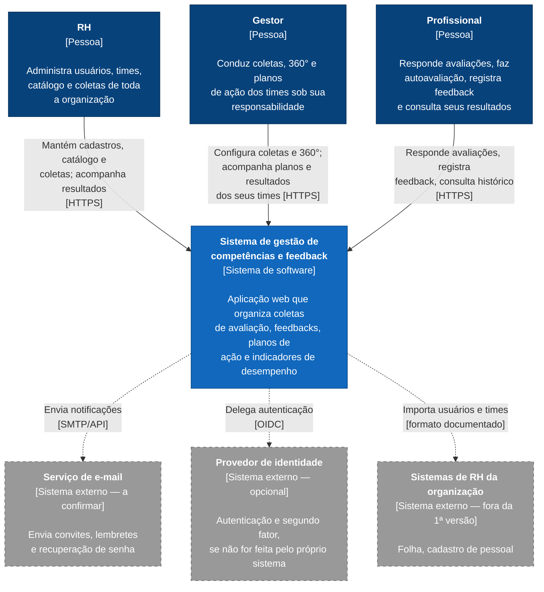
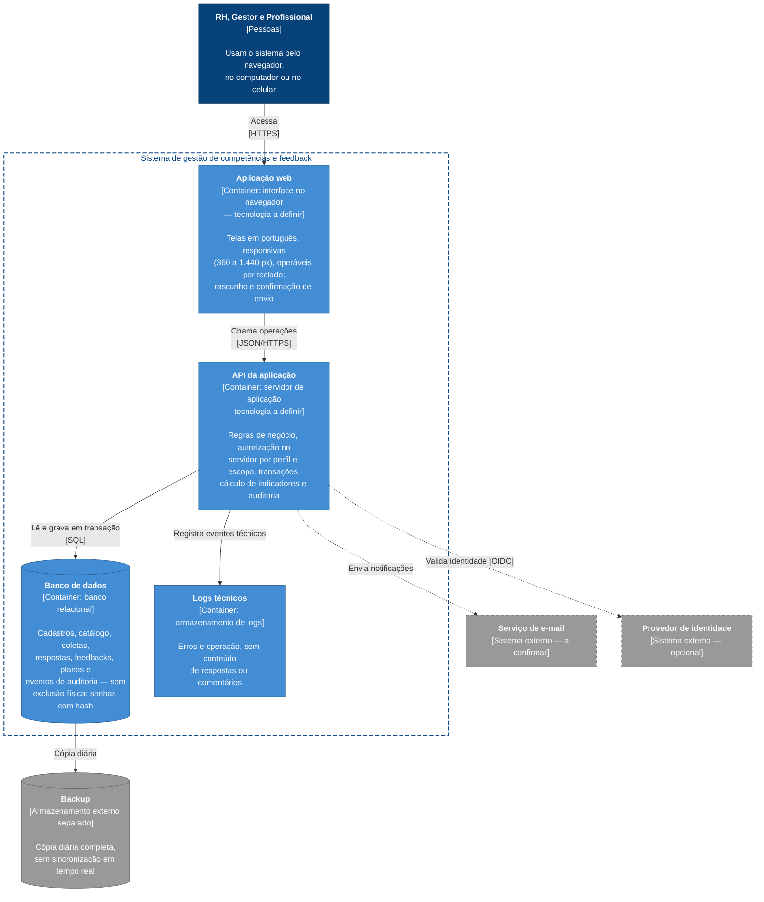
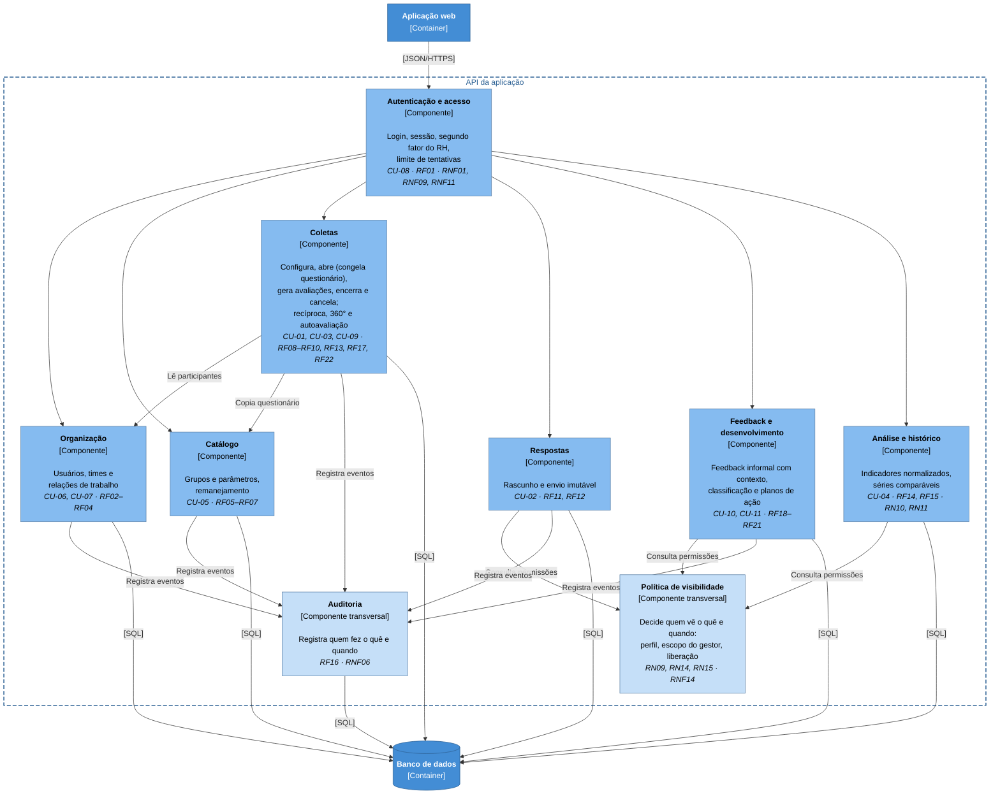

# Visão arquitetural de alto nível (modelo C4)

Autoria: Luiz Augusto Vaz. Versão 0.1 — 21 de novembro de 2026. Situação: **proposta para validação com a equipe e o stakeholder (#25)**.

Este documento mostra como o sistema de gestão de competências e feedback se organiza em alto nível, ligando cada parte aos requisitos que a motivam. Ele não escolhe linguagem, framework nem hospedagem: a [especificação suplementar](../../requisitos/especificacao-suplementar.md) (seção 5) deixa a tecnologia em aberto. Os diagramas mostram **responsabilidades e limites**, não produtos.

## 1. Notação e níveis adotados

O [modelo C4](https://c4model.com) descreve a arquitetura em quatro níveis de zoom. A equipe adotou os três primeiros:

| Nível | Diagrama | Pergunta que responde | Público |
| --- | --- | --- | --- |
| 1 | [Contexto](#3-nível-1--contexto-do-sistema) | Quem usa o sistema e com quais sistemas externos ele conversa? | Stakeholder, professor, equipe |
| 2 | [Containers](#4-nível-2--containers) | Em quais partes executáveis e de armazenamento o sistema se divide? | Equipe |
| 3 | [Componentes da API](#5-nível-3--componentes-da-api) | Como a lógica do servidor se divide e qual parte atende cada caso de uso? | Equipe |
| 4 | Código | — | Não se aplica: a primeira etapa é de requisitos e não há código. |

Legenda das cores, seguindo a convenção do C4: azul escuro para pessoas, azul para o sistema e seus containers, azul claro para componentes, cinza para sistemas externos. **Linha tracejada** indica elemento ou relação **ainda não confirmada** (opcional, a confirmar ou fora da primeira versão).

## 2. Direcionadores arquiteturais

Os requisitos abaixo são os que mais influenciam a estrutura. Cada decisão da seção 6 aponta para eles.

| Direcionador | Requisitos | Efeito na arquitetura |
| --- | --- | --- |
| Autorização sempre no servidor, negada por padrão | RNF01, RF01, RN14 | A API é a única porta para os dados; a aplicação web não decide permissões. |
| Liberação de resultados controlada | RN09, RN15, RNF14 | Regra de visibilidade concentrada em um componente testável. |
| Operações atômicas e sem duplicatas | RNF02, RN01, RN02 | Abertura da coleta, geração das avaliações e envio em uma única transação do banco. |
| Preservação e rastreabilidade | RN05, RN12, RF16, RNF06 | Banco relacional sem exclusão física; auditoria gravada junto com a operação. |
| Confidencialidade dos dados | RNF07, RNF08, RNF10 | HTTPS em todas as conexões; logs técnicos separados e sem conteúdo de respostas; senhas com *hash*. |
| Autenticação forte | RNF09, RNF11 | Componente de autenticação com segundo fator para o RH e limite de tentativas. |
| Recuperação | RNF05 | Backup diário em local separado do banco. |
| Interface acessível e responsiva | RNF03, RNF13 | Aplicação web única para computador e celular; sem aplicativo nativo. |
| Escopo e equipe da disciplina | Visão, seção 5.2 | Um único sistema implantável, sem integrações obrigatórias. |

## 3. Nível 1 — Contexto do sistema

Fonte editável: [c4-1-contexto.mmd](c4-1-contexto.mmd).



| Elemento | Tipo | Responsabilidade | Rastreabilidade | Situação |
| --- | --- | --- | --- | --- |
| RH | Pessoa | Administra cadastros, catálogo e coletas de toda a organização. | Visão 3.2; CU-01, CU-03, CU-05 a CU-07, CU-09, CU-11 | Proposto |
| Gestor | Pessoa | Atua nos times sob sua responsabilidade. | Visão 3.2; RN14; CU-01, CU-03, CU-04, CU-09, CU-11 | Proposto |
| Profissional | Pessoa | Responde, registra feedback e consulta seus resultados liberados. Qualquer perfil também é participante. | Visão 3.2; CU-02, CU-04, CU-08, CU-10, CU-11 | Proposto |
| Sistema de gestão de competências e feedback | Sistema | Objeto desta especificação. | Visão, seção 4 | Proposto |
| Serviço de e-mail | Externo | Notificações e recuperação de acesso. | Nenhum RF ainda — lacuna A01 (seção 7) | A confirmar |
| Provedor de identidade | Externo | Alternativa para autenticação e segundo fator. | RNF09; especificação suplementar, seção 5 ("provedor de identidade não definido") | Opcional |
| Sistemas de RH | Externo | Origem de cadastros, se houver integração. | RNF15; dúvida D-01; visão 5.2 | Fora da 1ª versão |

## 4. Nível 2 — Containers

Fonte editável: [c4-2-containers.mmd](c4-2-containers.mmd).



| Container | Responsabilidade | Não faz | Rastreabilidade |
| --- | --- | --- | --- |
| Aplicação web | Apresenta as telas do [protótipo no Figma](https://www.figma.com/design/pD7rcKYlK7cQ0M5KidV1kL/PulsarRH?node-id=1-3&t=DMEMqjiEkqlY5LWK-1); informa quem verá a resposta e quando; pede confirmação antes do envio. | Não decide permissões nem calcula indicadores. | RNF03, RNF13; restrições de plataforma e idioma |
| API da aplicação | Executa todas as regras de negócio e verifica autenticação, perfil e escopo em cada requisição. | Não guarda estado de sessão que impeça mais de uma instância (proposta). | RF01 a RF22; RN01 a RN16; RNF01, RNF02, RNF06, RNF12 |
| Banco de dados | Persiste o [MER](../dominio/modelo-entidade-relacionamento.md), incluindo `EVENTO_AUDITORIA`. Desativação lógica e cancelamento em vez de exclusão. | Não é acessado diretamente pela aplicação web nem por usuários. | RN05, RN12; RNF06, RNF10; restrição "banco relacional" |
| Logs técnicos | Guarda erros e métricas de operação. | Não registra notas, comentários nem o conteúdo de feedbacks. | RNF07 |
| Backup | Cópia diária completa em local separado. Meta proposta: perda máxima de 24 h e restauração em até 4 h. | Não é réplica em tempo real. | RNF05; PV07 |

## 5. Nível 3 — Componentes da API

Fonte editável: [c4-3-componentes-api.mmd](c4-3-componentes-api.mmd).



Cada componente agrupa os casos de uso que mexem nas mesmas entidades. Assim, cada parte do MER tem um único "dono" que a altera.

| Componente | Casos de uso | Requisitos | Entidades que altera ([MER](../dominio/modelo-entidade-relacionamento.md)) |
| --- | --- | --- | --- |
| Autenticação e acesso | CU-08 | RF01; RNF01, RNF09, RNF11 | Sessão e credenciais de `USUARIO` |
| Organização | CU-06, CU-07 | RF02, RF03, RF04; RN03, RN12 | `USUARIO`, `TIME`, `RELACAO_TRABALHO` |
| Catálogo | CU-05 | RF05, RF06, RF07; RN04, RN06 | `GRUPO_PARAM`, `PARAM` |
| Coletas | CU-01, CU-03, CU-09 | RF08, RF09, RF10, RF13, RF17, RF22; RN01 a RN05, RN07, RN15 | `COLETA`, `COLETA_TIME`, `COLETA_PAR`, `COLETA_PARTICIPANTE`, `COLETA_GRUPO`, `COLETA_PARAM`, `AVALIACAO` (criação e cancelamento) |
| Respostas | CU-02 | RF11, RF12; RN06, RN08 | `FEEDBACK`, estado de `AVALIACAO` |
| Feedback e desenvolvimento | CU-10, CU-11 | RF18 a RF21; RN13, RN16 | `REGISTRO_FEEDBACK`, `PLANO_ACAO`, `ACAO_PLANO`, `ACOMPANHAMENTO_ACAO` |
| Análise e histórico | CU-04 | RF14, RF15; RN09 a RN11; RNF04, RNF12 | Somente leitura de `AVALIACAO` e `FEEDBACK` |
| Política de visibilidade | Todos que exibem resultados | RN09, RN14, RN15; RNF01, RNF14, RNF16 | Nenhuma (só decide) |
| Auditoria | Todos que alteram dados | RF16; RNF06 | `EVENTO_AUDITORIA` (somente inclusão) |

## 6. Decisões arquiteturais propostas

Registradas no formato curto de *Architecture Decision Record*. Todas estão **propostas** até a revisão da equipe.

| ID | Decisão | Motivo | Alternativa descartada | Requisitos |
| --- | --- | --- | --- | --- |
| AD01 | Um único servidor de aplicação dividido em componentes (monólito modular). | As regras de coleta, resposta e liberação dependem umas das outras e precisam de transações únicas; o escopo é de uma disciplina. | Microsserviços: exigiriam transações distribuídas para RN01 e RNF02 sem ganho para o volume previsto (RNF04: 50 usuários simultâneos). | RNF02, RNF04 |
| AD02 | Toda decisão de acesso fica na API, centralizada no componente Política de visibilidade. | Uma regra de visibilidade duplicada na interface pode vazar resultados; um ponto único facilita testes. | Esconder dados apenas na interface. | RNF01, RNF14, RN09 |
| AD03 | Eventos de auditoria são gravados no mesmo banco e na mesma transação da operação. | Garante que não existe operação sem evento nem evento sem operação; o MER já tem `EVENTO_AUDITORIA`. | Auditoria só em arquivo de log. | RF16, RNF06 |
| AD04 | Logs técnicos ficam separados dos dados de negócio e nunca recebem conteúdo de respostas. | Logs costumam ter acesso mais amplo e retenção diferente. | Registrar o corpo das requisições para depuração. | RNF07 |
| AD05 | Diagramas sem tecnologias definidas. | A tecnologia ainda está em aberto; escolher agora seria decisão sem fonte. | Fixar uma pilha só para preencher o diagrama. | Especificação suplementar, seção 5 |

## 7. Lacunas e pontos a confirmar

| ID | Ponto | Encaminhamento |
| --- | --- | --- |
| A01 | Nenhum requisito pede notificação por e-mail (convite para responder, lembrete de prazo) nem recuperação de senha, mas os fluxos de coleta e o RNF09 sugerem essa necessidade. | Perguntar ao stakeholder na validação (#25); se confirmado, criar RF e manter o serviço de e-mail no diagrama. |
| A02 | Autenticação própria ou provedor de identidade externo. | Depende da escolha de tecnologia e do RNF09 (segundo fator do RH). |
| A03 | Integração com sistemas de RH. | Fora da primeira versão (visão 5.2); depende da D-01 e do RNF15. |
| A04 | Anonimato das respostas. | Se adotado (conflito C02), a Política de visibilidade e a Auditoria precisam esconder o autor (RNF16) — pode exigir separar o vínculo resposta–autor no banco. |
| A05 | Metas de desempenho e recuperação. | Metas do RNF04 e do RNF05 dependem da PV07. |

## 8. Arquivos

| Arquivo | Conteúdo |
| --- | --- |
| [c4-1-contexto.mmd](c4-1-contexto.mmd) | Nível 1 — contexto |
| [c4-2-containers.mmd](c4-2-containers.mmd) | Nível 2 — containers |
| [c4-3-componentes-api.mmd](c4-3-componentes-api.mmd) | Nível 3 — componentes da API |

O GitHub desenha os diagramas Mermaid deste README direto na página. Ao alterar um `.mmd`, copie o mesmo conteúdo para o bloco correspondente deste README. Para gerar as imagens, a partir desta pasta:

```bash
npx -p @mermaid-js/mermaid-cli mmdc -i c4-1-contexto.mmd -o exportacoes/c4-1-contexto.png -b white -s 2
npx -p @mermaid-js/mermaid-cli mmdc -i c4-2-containers.mmd -o exportacoes/c4-2-containers.png -b white -s 2
npx -p @mermaid-js/mermaid-cli mmdc -i c4-3-componentes-api.mmd -o exportacoes/c4-3-componentes-api.png -b white -s 2
```
