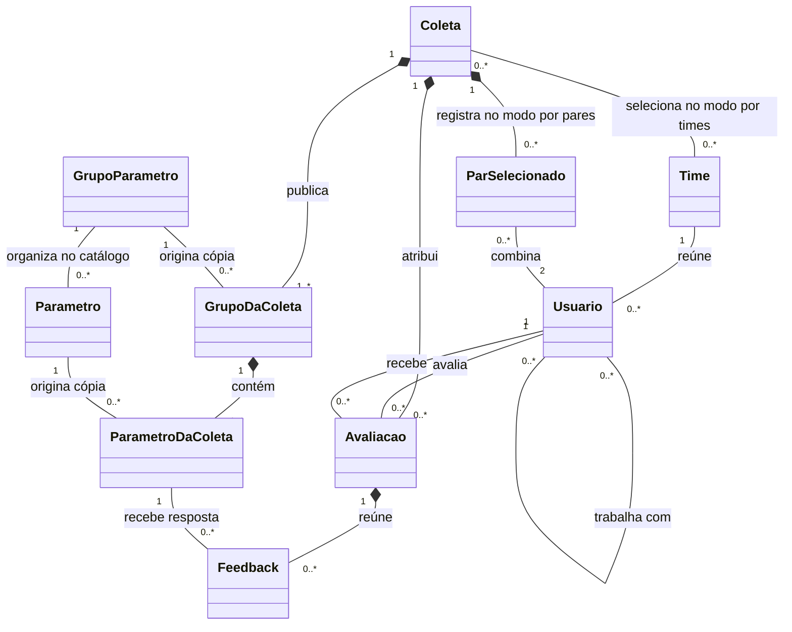

# Modelo de domínio do sistema de feedbacks

O domínio é a avaliação e o acompanhamento de pessoas por meio de feedbacks estruturados. Uma coleta estabelece quem avalia quem e qual questionário será utilizado. A avaliação é mútua, mas cada participante responde de forma independente.

## Conceitos e linguagem do negócio

**Usuário** é uma pessoa cadastrada, vinculada a um time, com nome, cargo e perfil de acesso. Uma mesma pessoa pode atuar como avaliador em uma avaliação e receptor em outra. Esses papéis são circunstanciais e não novos valores do ENUM de acesso.

**Profissional** é o significado do perfil `PROF`, que identifica o participante comum. Os demais perfis são RH e GESTOR. Permanece proposta a utilização de um único perfil por conta.

**Time** é uma unidade organizacional com nome e setor. Na proposta, possui um gestor responsável e reúne usuários. A responsabilidade de gestão pode abranger vários times, independentemente do time de lotação do próprio gestor.

**Relação de trabalho** indica que dois usuários trabalham juntos e podem ser selecionados como um par no modo de seleção manual. A proposta interpreta `trabalha_com` como um vínculo simétrico, não como texto livre. No modo por times, pertencer ao mesmo time selecionado é suficiente para gerar a combinação, sem exigir vínculo individual prévio.

**Parâmetro** é uma pergunta de avaliação. Seu `score` define o tipo de avaliação: `ESCALA_0_10`, `ESCALA_0_5` ou `BOOLEANO`. Nas escalas, a resposta é uma nota inteira dentro do intervalo; no tipo booleano, é verdadeiro ou falso, apresentado como Sim ou Não. **Grupo de parâmetros** reúne perguntas por tema, como Comunicação ou Colaboração. Um parâmetro possui um grupo atual no catálogo e pode ser remanejado.

**Coleta** é uma campanha com título, período, estado, questionário e modo de seleção de participantes: pares ou times. No modo por pares, o RH escolhe os pares elegíveis individualmente. No modo por times, o RH escolhe um ou mais times e o sistema forma todos os pares de integrantes elegíveis dentro de cada time. Selecionar vários times não cria combinações entre times diferentes. **Questionário da coleta** é a cópia dos grupos e perguntas selecionados para aquela campanha. A cópia permanece estável após a abertura.

**Avaliação** é o preenchimento do questionário por uma pessoa sobre outra em uma coleta. O par A e B produz duas avaliações, e não uma resposta compartilhada.

**Feedback** é a resposta a uma pergunta da avaliação, contendo valor compatível com o tipo definido em `score` e comentário opcional. Zero e falso são respostas válidas. O conjunto de feedbacks ativos compõe o questionário respondido. O status pertence à avaliação e é exposto em cada feedback por derivação; o atributo `ativo` indica se a resposta integra o preenchimento atual.

**Histórico** é o conjunto de avaliações e resultados preservados ao longo das coletas. **Análise individual** é a leitura dos resultados recebidos por uma pessoa, filtrada e calculada sobre respostas válidas e comparáveis.

## Modelo de domínio conceitual

O diagrama mostra conceitos do negócio. Os detalhes de chaves e tabelas pertencem ao MER.

As cardinalidades de um ou mais grupos e perguntas descrevem os itens ativos da coleta publicada. Uma coleta em preparação pode estar vazia. Cada avaliação enviada deve conter uma resposta ativa por pergunta ativa publicada, embora rascunhos possam estar vazios. A autorrelação de usuários é simétrica e proíbe vínculo consigo mesmo.

## Responsabilidades do domínio

O catálogo define os grupos e perguntas disponíveis para futuras coletas. A coleta controla o questionário publicado, o período, o modo de seleção e os pares escolhidos ou gerados a partir dos times. A abertura determina os integrantes elegíveis e congela os pares; mudanças posteriores na composição do time não incluem nem removem avaliações automaticamente. A avaliação controla autoria, destinatário, respostas e envio. A análise consulta resultados preservados; não altera notas nem substitui o questionário histórico pelo catálogo atual.

Perfis controlam permissões de operação. Cargo descreve a função profissional e não concede autorização automaticamente. Time organiza pessoas, enquanto o vínculo de gestão determina o escopo de acompanhamento do gestor.

Não há exclusão física de dados, mesmo de cadastros sem dependências ou rascunhos. Cadastros, vínculos e respostas em rascunho são desativados; coletas e avaliações são canceladas. Alterações na seleção durante a preparação desativam os vínculos anteriores, preservando seus registros. Notas numéricas e respostas booleanas são analisadas separadamente: médias para escalas e proporções de Sim e Não para booleanos.

## Fluxo principal

1. O RH cadastra times, usuários e relações de trabalho.
2. O RH organiza os parâmetros em grupos e prepara uma coleta.
3. O RH escolhe o modo de seleção por pares ou por times. No primeiro, seleciona os pares elegíveis; no segundo, seleciona os times e o sistema combina todos os integrantes elegíveis de cada time entre si. Antes de publicar, o RH visualiza os participantes e a quantidade de avaliações. A abertura preserva as cópias do questionário, congela os participantes e gera os dois sentidos de avaliação para cada par, sem autoavaliações nem duplicatas.
4. Cada avaliador salva seus rascunhos e envia o questionário completo dentro do período.
5. O RH encerra a coleta e o sistema cancela as pendências, preservando envios.
6. Os resultados elegíveis são liberados e passam a compor o histórico e a análise, conforme as permissões propostas.

## Exemplo de reciprocidade

Ana e Bruno trabalham juntos. Em uma coleta com três perguntas, o sistema cria uma avaliação de Ana sobre Bruno e outra de Bruno sobre Ana. Cada uma pode conter até três respostas em rascunho e exatamente três no envio. A coleta produzirá seis respostas se ambos concluírem.

Na política proposta, Ana não vê o conteúdo recebido antes de enviar sua avaliação. A liberação ocorre após ambos concluírem e a coleta ser encerrada. A identidade dos participantes é conhecida; reciprocidade entre duas pessoas não implica anonimato.

## Exemplo de seleção por time

O RH seleciona um time com Ana, Bruno e Carla, todos ativos. O sistema forma os pares Ana e Bruno, Ana e Carla, Bruno e Carla, gerando seis avaliações: Ana sobre Bruno, Bruno sobre Ana, Ana sobre Carla, Carla sobre Ana, Bruno sobre Carla e Carla sobre Bruno. Cada pessoa avalia as outras duas, mesmo que não haja vínculos individuais cadastrados em `trabalha_com`.

Um time com `n` integrantes elegíveis gera `n × (n − 1) / 2` pares e `n × (n − 1)` avaliações direcionadas. Cada time selecionado deve possuir pelo menos dois integrantes elegíveis na abertura. Usuários inativos são excluídos da geração. Se mais de um time for selecionado, a regra é aplicada separadamente dentro de cada um. Entradas, saídas ou transferências após a abertura não modificam as avaliações geradas.

## Exemplo de remanejamento

O parâmetro P1 pertence ao grupo Comunicação e integra a coleta C1. Após sua abertura, o RH move P1 para Colaboração no catálogo. C1 conserva a pergunta no grupo Comunicação. Uma futura coleta C2 pode copiar P1 em Colaboração. Dessa forma, a organização atual não reescreve o contexto da avaliação anterior.

## Limites e decisões propostas

Não há autoavaliação, pesos individuais, múltiplos grupos simultâneos para o mesmo parâmetro nem formulários diferentes por par nesta versão. `PROF` significa profissional e `score` define o tipo de avaliação, conforme confirmado pelo stakeholder na entrevista E01. Permissões, multiplicidade de perfis e política de liberação dependem das pendências da [especificação](../../requisitos/especificacao-requisitos.md). Planos de ação, metas e avaliação 360° constituem extensões a detalhar.
