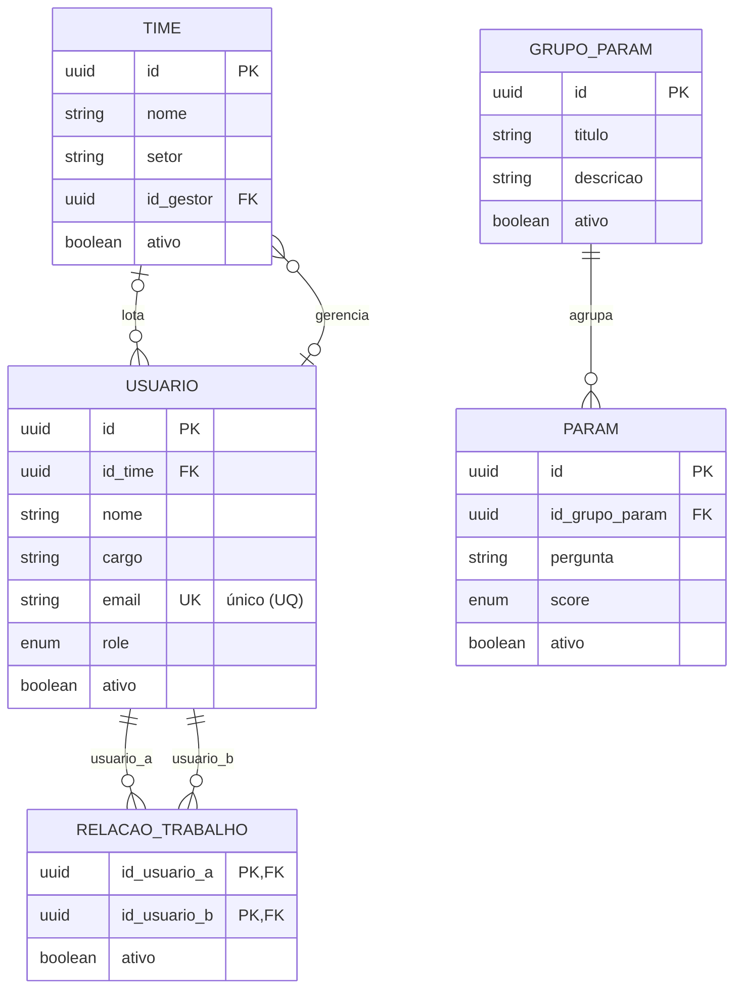
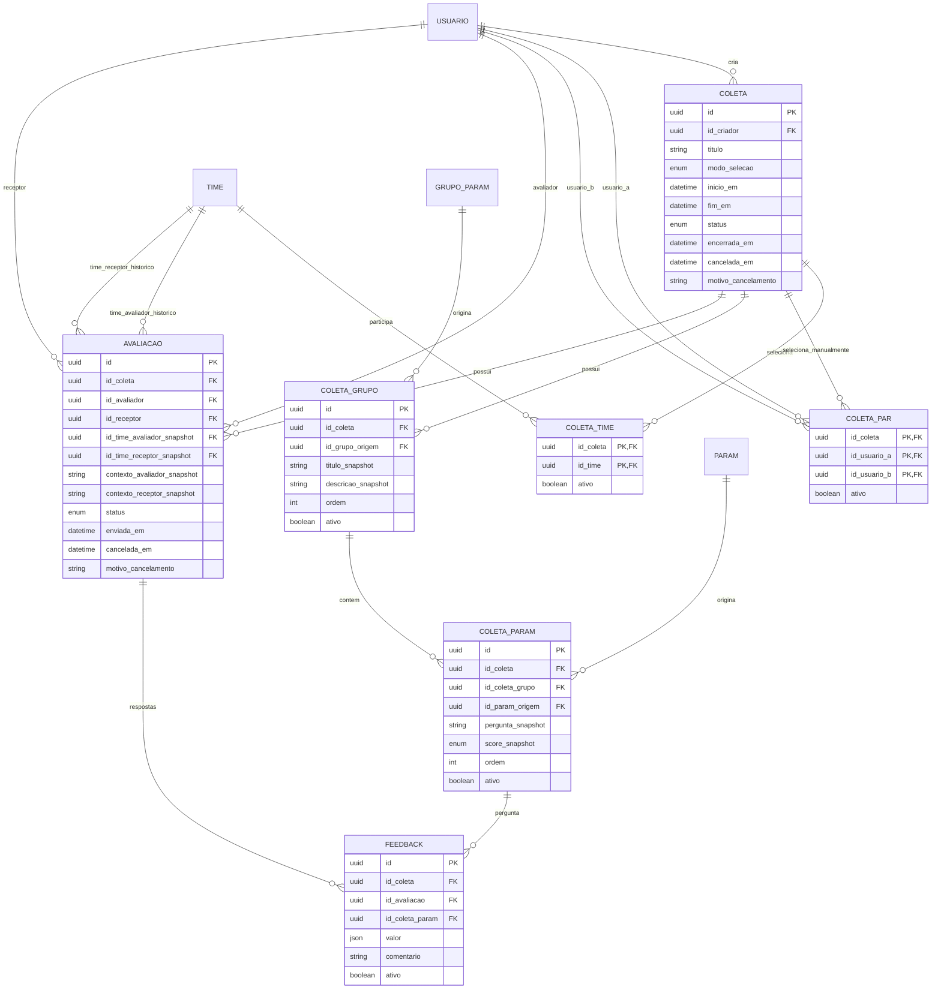

# Modelo entidade-relacionamento

Modelo lógico proposto para armazenar coletas com avaliação mútua e questionários históricos. Os nomes originais são preservados conceitualmente; campos derivados e relações substituem duplicações e listas de identificadores.

## Convenções

`PK` indica chave primária, `FK` chave estrangeira e `UQ` unicidade. IDs são UUIDs propostos. Os tipos e limites completos estão no [dicionário](../../dicionario-dados.md). A implementação pode escolher outro tipo de identificador, mantendo as restrições.

O modelo é relacional e normaliza o catálogo e as respostas. As cópias de perguntas e de organização nas coletas são redundância histórica intencional, usada para impedir mudanças retroativas.

## Estrutura organizacional e catálogo



Um time possui zero ou muitos usuários. O vínculo de lotação é opcional durante o cadastro, mas obrigatório para participar de uma nova coleta. Um gestor pode ser responsável por vários times; um time tem no máximo um gestor responsável. Este vínculo não exige que o gestor esteja lotado no time que gerencia. O sistema deve verificar que o responsável possui role `GESTOR`.

A relação de trabalho resolve a associação muitos para muitos entre usuários e determina a elegibilidade na seleção manual de pares. No modo por times, o pertencimento ao mesmo time selecionado basta para combinar os integrantes elegíveis; não é necessário criar relações de trabalho individuais. O par da relação é armazenado em ordem canônica, com `id_usuario_a < id_usuario_b`, segundo uma ordenação estável dos IDs, para impedir duplicação do vínculo inverso.

Cada parâmetro pertence a exatamente um grupo atual. A lista de parâmetros de um grupo é obtida consultando `PARAM.id_grupo_param`; não existe coluna `list_id_params` no armazenamento.

## Coletas e respostas



Os campos de contexto do diagrama abreviam conjuntos de atributos: nome, cargo, nome do time e setor de cada participante. O dicionário enumera cada campo individualmente. O time histórico é usado para filtrar resultados pelo contexto da avaliação; alterar a lotação atual não muda esse vínculo. O gestor atual responsável pelo time histórico é quem recebe o escopo de acompanhamento proposto.

No armazenamento, uma coleta em preparação pode não ter grupos nem seleções de participantes. Para abrir, deve ter ao menos um grupo ativo, um parâmetro ativo em cada grupo ativo e um par válido, selecionado manualmente ou gerado a partir dos times. No modo TIMES, cada time selecionado por vínculo ativo deve ter pelo menos dois integrantes elegíveis. Uma avaliação pode não ter respostas em rascunho; no envio, deve ter uma resposta ativa para cada parâmetro ativo publicado.

`COLETA.modo_selecao` admite PARES ou TIMES. COLETA_TIME registra os times escolhidos no modo TIMES e COLETA_PAR registra os pares manuais no modo PARES. Apenas os vínculos ativos do modo vigente compõem a seleção. Vínculos antigos permanecem armazenados e inativos. As avaliações são criadas somente na abertura e preservam os integrantes efetivos e seus contextos; a lotação atual dos usuários não deve ser usada para reconstruir participantes históricos.

## Entidades e responsabilidades

- `USUARIO`: identidade organizacional, lotação e perfil.
- `TIME`: unidade organizacional e responsabilidade de gestão.
- `RELACAO_TRABALHO`: elegibilidade dos pares escolhidos manualmente.
- `GRUPO_PARAM`: grupo atual do catálogo.
- `PARAM`: pergunta atual e escala de pontuação.
- `COLETA`: campanha, modo de seleção e controle do período de resposta.
- `COLETA_TIME`: associação dos times selecionados com a coleta, no modo TIMES.
- `COLETA_PAR`: seleção manual de pares da coleta, no modo PARES, preservada mesmo quando desativada.
- `COLETA_GRUPO`: grupo selecionado e cópia de seu contexto.
- `COLETA_PARAM`: pergunta selecionada e cópia da sua escala.
- `AVALIACAO`: atribuição em um sentido, autoria e estado do questionário.
- `FEEDBACK`: valor e comentário de uma pergunta.
- `EVENTO_AUDITORIA`: registro das operações administrativas e transições relevantes.

## Chaves e restrições

### Organização

- `USUARIO.email`: único após remoção de espaços externos e conversão para minúsculas.
- `USUARIO.role`: somente `RH`, `PROF` ou `GESTOR`; PROF significa profissional. Um perfil por conta continua como proposta.
- `RELACAO_TRABALHO`: PK composta por `(id_usuario_a, id_usuario_b)`, com A menor que B. Reativação reutiliza o vínculo existente.
- `PARAM.score`: ENUM `ESCALA_0_10 | ESCALA_0_5 | BOOLEANO`, obrigatório, define o tipo de avaliação; `PARAM.id_grupo_param` obrigatório.
- `TIME.id_gestor`: opcional, mas quando preenchido deve apontar para usuário ativo com role `GESTOR`. Troca de perfil ou desativação exige encerrar ou substituir suas responsabilidades na mesma operação, preservando a alteração em auditoria.

### Composição de coletas

- `COLETA.inicio_em < COLETA.fim_em`.
- `COLETA.modo_selecao`: somente `PARES` ou `TIMES`, obrigatório.
- `COLETA_TIME`: PK composta por `(id_coleta, id_time)`, com FKs para COLETA e TIME; um time só pode ser selecionado uma vez por coleta.
- `COLETA_PAR`: PK composta por `(id_coleta, id_usuario_a, id_usuario_b)`, com FKs para COLETA e USUARIO e ordem canônica `id_usuario_a < id_usuario_b`. Reativar um par reutiliza a mesma linha.
- No modo PARES, deve haver pelo menos um COLETA_PAR ativo e nenhum COLETA_TIME ativo na abertura. No modo TIMES, deve haver pelo menos um COLETA_TIME ativo e nenhum COLETA_PAR ativo. Vínculos inativos podem permanecer em ambos os modos. Validar essa consistência transacionalmente.
- Trocar o modo na preparação desativa as seleções anteriores na mesma transação, sem apagar linhas. As avaliações ainda não existem nessa fase. Após a abertura, modo e seleções são imutáveis.
- UQ de `COLETA_GRUPO(id_coleta, id_grupo_origem)` e unicidade de `(id_coleta, ordem)` entre grupos ativos.
- UQ de `COLETA_PARAM(id_coleta, id_param_origem)`; a mesma pergunta de origem não pode aparecer em dois grupos da mesma coleta.
- Unicidade de `COLETA_PARAM(id_coleta_grupo, ordem)` entre perguntas ativas. As unicidades de ordem condicionadas à atividade podem ser implementadas com índice único filtrado ou mecanismo equivalente.
- Chave candidata `COLETA_GRUPO(id, id_coleta)` e FK composta de `COLETA_PARAM(id_coleta_grupo, id_coleta)`, impedindo indicar grupo de outra coleta.
- COLETA_GRUPO e COLETA_PARAM usam `ativo` para retirar itens durante a preparação, sem exclusão física. Desativar grupo desativa suas perguntas selecionadas na mesma transação; reativar não cria duplicatas. A publicação considera apenas grupos e perguntas ativos, exigindo pelo menos uma pergunta ativa por grupo ativo. Após a abertura, as cópias não podem ser alteradas nem desativadas.
- Na preparação, a composição pode ser editada. A abertura recopia os textos e escalas atuais dos itens selecionados, valida os vínculos e congela a configuração. Se o catálogo tiver sido remanejado, a divergência deve ser apresentada ao RH para atualização explícita; a abertura não move perguntas silenciosamente.

### Atribuição e respostas

- `AVALIACAO.id_avaliador != AVALIACAO.id_receptor`.
- UQ de `AVALIACAO(id_coleta, id_avaliador, id_receptor)`.
- No modo PARES, COLETA_PAR registra as seleções manuais na preparação; a abertura revalida usuários, times e relação de trabalho e gera as duas avaliações de cada par ativo. No modo TIMES, COLETA_TIME registra a seleção e a abertura resolve os usuários ativos lotados em cada time selecionado por vínculo ativo, sem exigir vínculos individuais em RELACAO_TRABALHO. A prévia dos participantes e das contagens deve ser atualizada e confirmada pelo RH se a composição mudar antes da abertura.
- Para cada time selecionado com `n` integrantes elegíveis, a abertura gera todas as combinações internas: `n × (n − 1) / 2` pares e `n × (n − 1)` avaliações. Não gera combinações entre times distintos, nem autoavaliações. Cada time selecionado deve ter ao menos dois integrantes elegíveis.
- A abertura, as cópias do questionário e todas as avaliações devem ser persistidas em uma única transação, garantindo os dois sentidos de todo par de forma idempotente. Uma falha reverte a operação completa. Somente coleta aberta admite edição de respostas.
- Mudanças de integrantes ou de lotação após a abertura não alteram os pares gerados. O conjunto histórico de participantes é obtido das avaliações preservadas, não dos membros atuais do time.
- O par inverso deve existir; a criação é sempre recíproca e não há exclusão física. É uma invariável transacional do serviço de domínio; uma simples FK não garante sua existência recíproca.
- Chaves candidatas de `AVALIACAO(id, id_coleta)` e de `COLETA_PARAM(id, id_coleta)`.
- FKs compostas de `FEEDBACK(id_avaliacao, id_coleta)` e de `FEEDBACK(id_coleta_param, id_coleta)` devem referenciar essas chaves. Isso impede resposta a pergunta de outra coleta. `id_coleta` é redundância controlada para essa integridade.
- UQ de `FEEDBACK(id_avaliacao, id_coleta_param)`.
- `COLETA_PARAM.score_snapshot` preserva o ENUM do tipo de avaliação publicado. FEEDBACK.valor é um escalar JSON tipado: número inteiro de 0 a 10 para ESCALA_0_10, inteiro de 0 a 5 para ESCALA_0_5 ou booleano nativo para BOOLEANO. Objetos, arrays, strings, nulo e tipos incompatíveis são rejeitados. Zero e falso são valores válidos e distintos de ausência de resposta.
- Como a validação depende de outra tabela, deve ocorrer transacionalmente no serviço ou com mecanismo equivalente do banco; não usar um `CHECK` local fictício. JSON é uma proposta de armazenamento para preservar a distinção entre inteiro e booleano, não uma permissão de conteúdo arbitrário.
- FEEDBACK.ativo permite desativar e reativar a linha em rascunho, mantendo a UQ por avaliação e pergunta. Completude e análise consideram apenas respostas ativas. Após envio, nenhuma resposta pode ser alterada nem desativada.
- Envios, completude, período e imutabilidade devem ser validados no servidor, incluindo chamadas diretas à API.

### Cancelamento e preservação

`COLETA` admite `PREPARACAO`, `ABERTA`, `ENCERRADA` e `CANCELADA`. `AVALIACAO` admite `RASCUNHO`, `ENVIADA` e `CANCELADA`. O estado do feedback é derivado do estado da avaliação.

Em cancelamento de par, avaliações em rascunho passam a `CANCELADA`; se houver uma enviada, ela mantém `ENVIADA`, mas o par fica inelegível porque o sentido inverso está cancelado. Se ambas já estiverem enviadas, o cancelamento do par não é permitido nesta versão; uma invalidação posterior exige política adicional. Coleta cancelada exclui todos os seus pares das análises sem alterar os estados dos envios.

Nenhuma entidade admite exclusão física, inclusive cadastros sem vínculos, seleções de preparação e rascunhos. Cadastros, vínculos, cópias em preparação e respostas em rascunho usam `ativo`; coletas e avaliações usam cancelamento. Cancelar uma coleta em preparação preserva todas as suas seleções e cópias. Chaves estrangeiras não usam cascata de exclusão. A aplicação não oferece operação de expurgo. Depois da abertura, somente transições previstas são permitidas.

## Visão de compatibilidade com o feedback original

O formato de consulta pode expor exatamente os campos solicitados, sem armazenar os mesmos dados em todas as respostas:

```text
feedback.id            = FEEDBACK.id
feedback.id_param      = COLETA_PARAM.id_param_origem
feedback.id_avaliador  = AVALIACAO.id_avaliador
feedback.id_receptor   = AVALIACAO.id_receptor
feedback.valor         = FEEDBACK.valor
feedback.comentario    = FEEDBACK.comentario
feedback.status        = AVALIACAO.status
feedback.ativo         = FEEDBACK.ativo
```

A consulta também deve fornecer `id_coleta`, `id_avaliacao` e `id_coleta_param` para distinguir ocorrências históricas do mesmo parâmetro. O campo `id_param` de origem identifica o catálogo; o preenchimento usa `id_coleta_param`, que identifica a pergunta exata publicada.

## Auditoria

`EVENTO_AUDITORIA` contém ID, ator opcional, operação, tipo de entidade, chave do alvo, instante e metadados administrativos mínimos. A chave do alvo preserva todos os componentes da PK em `chave_alvo`, inclusive para entidades com chave composta; `id_alvo` é opcional e usado para PK simples. O ator é opcional para eventos automáticos. O alvo é uma referência lógica a um registro preservado, inclusive após desativação ou cancelamento. Metadados registram, por exemplo, os IDs dos grupos anterior e novo em um remanejamento; não copiam comentários de avaliações. Eventos não podem ser alterados ou excluídos.

O cadastro de usuários e a autenticação são separados. Nenhuma senha em texto puro pertence a estas entidades.
