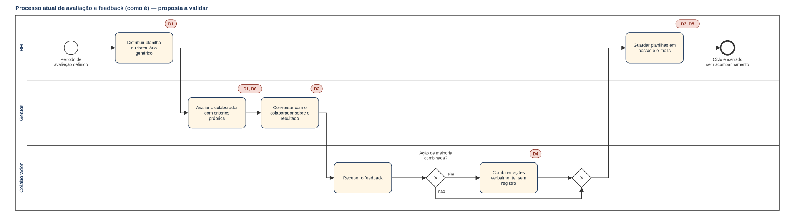
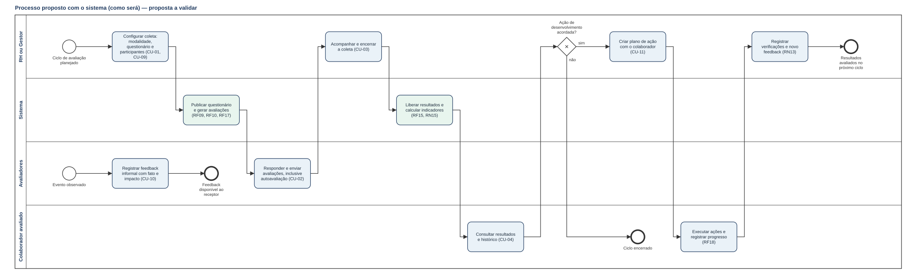

# Processo de negócio (BPMN)

Atende ao item "Entendimento do processo de negócio de avaliação (principais dores) — na notação de BPMN" do enunciado e à issue #10. Autoria: Luiz Augusto Vaz. Situação: **proposta para validação com o stakeholder (#25)**.

Os diagramas seguem a notação BPMN 2.0 (OMG). Os arquivos `.bpmn` abrem e podem ser editados em [bpmn.io](https://demo.bpmn.io) ou no Camunda Modeler; os `.svg` são a visualização dos mesmos modelos.

| Arquivo | Conteúdo |
| --- | --- |
| [processo-atual.bpmn](processo-atual.bpmn) · [svg](processo-atual.svg) | Como a avaliação acontece sem o sistema (como é), com as dores marcadas |
| [processo-proposto.bpmn](processo-proposto.bpmn) · [svg](processo-proposto.svg) | Como a avaliação acontece com o sistema (como será), com os casos de uso e requisitos de cada etapa |

## Limites deste modelo

As entrevistas foram orais, sem gravação, e estão registradas como resumo anotado das respostas; a síntese descreve o processo desejado, não o processo atual de uma organização específica. Por isso, o processo atual foi modelado em nível geral, a partir do problema registrado no [documento de visão](../../visao.md) (seção 2.1) e dos problemas organizacionais levantados na [análise do Culture Amp](../../levantamento/analise-sistema-analogo-culture-amp.md) (seção 2.3). Cada etapa e cada dor deve ser confirmada ou corrigida na validação com o stakeholder; nada aqui é relato de uma situação real observada.

## Processo atual (como é)

| Dor | Descrição | Onde aparece | Fonte |
| --- | --- | --- | --- |
| D1 | Critérios de avaliação não padronizados; cada gestor avalia do seu jeito | Distribuir planilha; avaliar com critérios próprios | Visão, 2.1; SA, 2.3 ("avaliações subjetivas") |
| D2 | Feedback restrito aos ciclos formais, sem registro contínuo entre eles | Conversa de resultado | SA, 2.3 ("falta de comunicação") e 3.3 |
| D3 | Histórico perdido ou disperso; resultados difíceis de comparar entre ciclos | Guardar planilhas | Visão, 2.1; SA, 2.3 ("falta de histórico") |
| D4 | Ações de melhoria combinadas sem registro nem acompanhamento | Combinar ações verbalmente | Visão, 3.3; SA, 2.3 ("ausência de acompanhamento") |
| D5 | Dados pessoais guardados sem controle de acesso | Guardar planilhas | Visão, 2.1 ("risco de exposição indevida") |
| D6 | Visão limitada do desempenho: só o gestor avalia | Avaliar com critérios próprios | SA, 2.3 ("visão limitada do desempenho") |

## Processo proposto (como será)

| Etapa | Responsável | Caso de uso e requisitos | Dor tratada |
| --- | --- | --- | --- |
| Configurar coleta: modalidade, questionário e participantes | RH ou gestor | CU-01, CU-09; RF08, RF17, RN14 | D1, D6 |
| Publicar questionário e gerar avaliações | Sistema | RF09, RF10, RF17; RN05 | D1 |
| Responder e enviar avaliações, inclusive autoavaliação | Avaliadores | CU-02; RF11, RF12, RF22 | D6 |
| Acompanhar e encerrar a coleta | RH ou gestor | CU-03; RF13 | — |
| Liberar resultados e calcular indicadores | Sistema (no diagrama); gestor ou RH liberam os resultados (RN09) | CU-04; RF15; RN09, RN10, RN15 | D3 |
| Consultar resultados e histórico | Colaborador avaliado | CU-04; RF14, RF15 | D3 |
| Criar plano de ação com o colaborador | RH ou gestor | CU-11; RF18; RN13 | D4 |
| Executar ações e registrar progresso | Colaborador avaliado | CU-11; RF18 | D4 |
| Registrar verificações e novo feedback | RH ou gestor | CU-11; RN13 | D4 |
| Registrar feedback informal com fato e impacto | Qualquer participante | CU-10; RF19 a RF21; RN16 | D2 |

Na validação dos requisitos (E01, E02), a liberação dos resultados passou a ser feita pelo gestor ou pelo RH (RN09). O diagrama ainda mostra essa etapa na raia do sistema e deve ser ajustado na validação do BPMN (#10).

O controle de acesso por perfil e escopo (RF01, RN14, RNF01, RNF07) e a auditoria (RF16) atravessam todas as etapas e tratam a dor D5.

## Pontos para a validação

- O processo atual descrito corresponde ao que acontece na organização? Quais etapas faltam?
- As dores D1 a D6 são as principais? Há outras?
- Quem abre o ciclo de avaliação: só o RH, ou também o gestor?
- Quando há plano de ação, quem registra as verificações e com que frequência?
