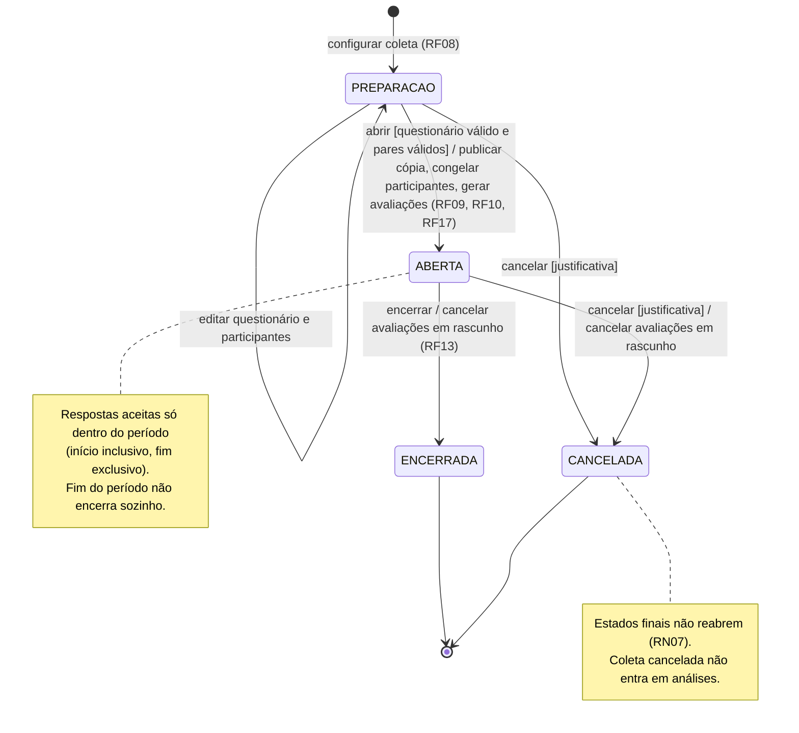
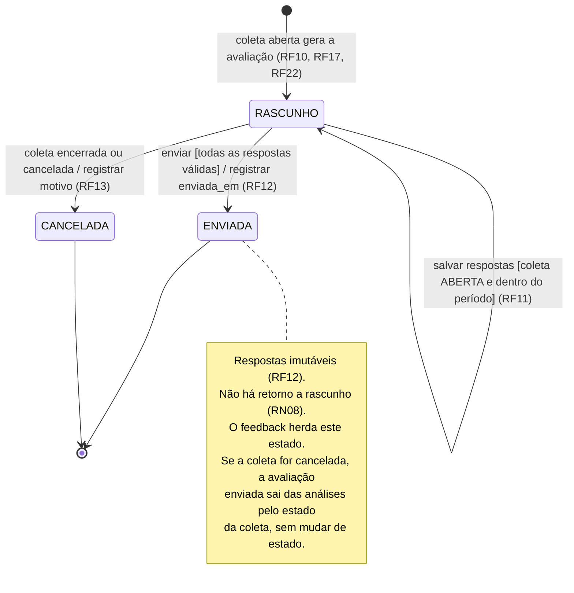
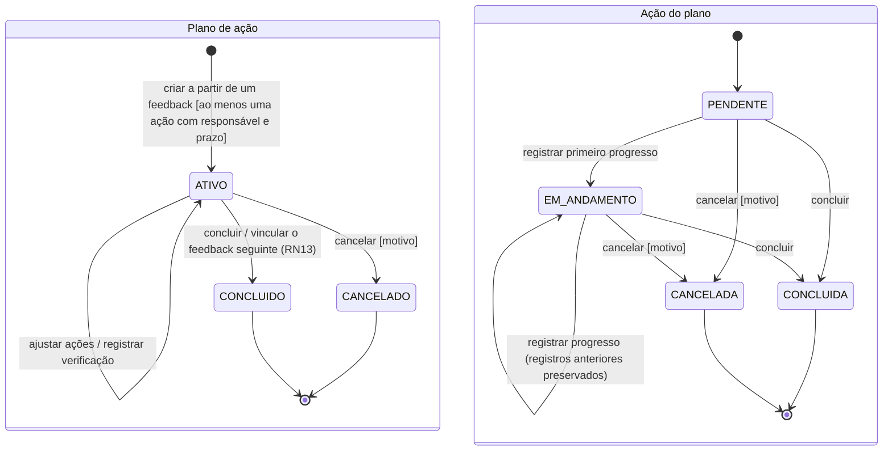
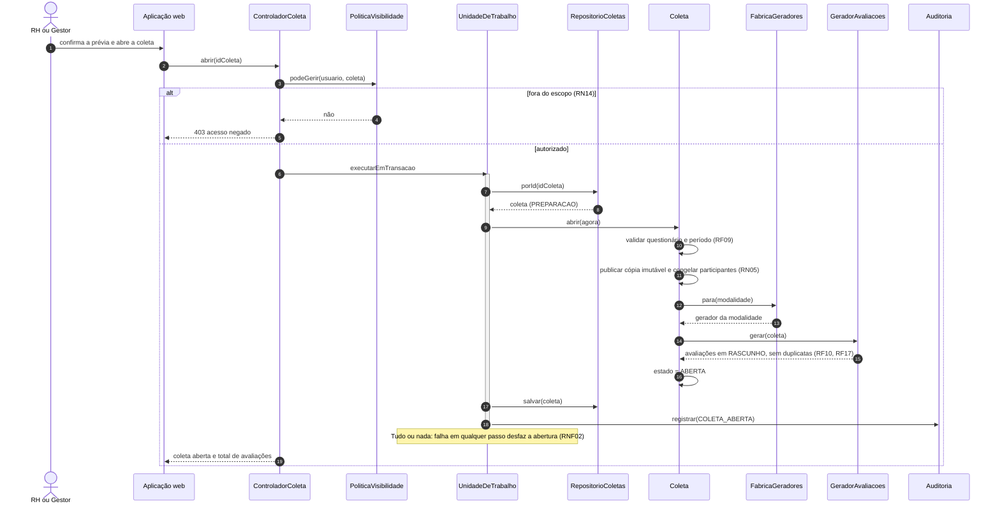
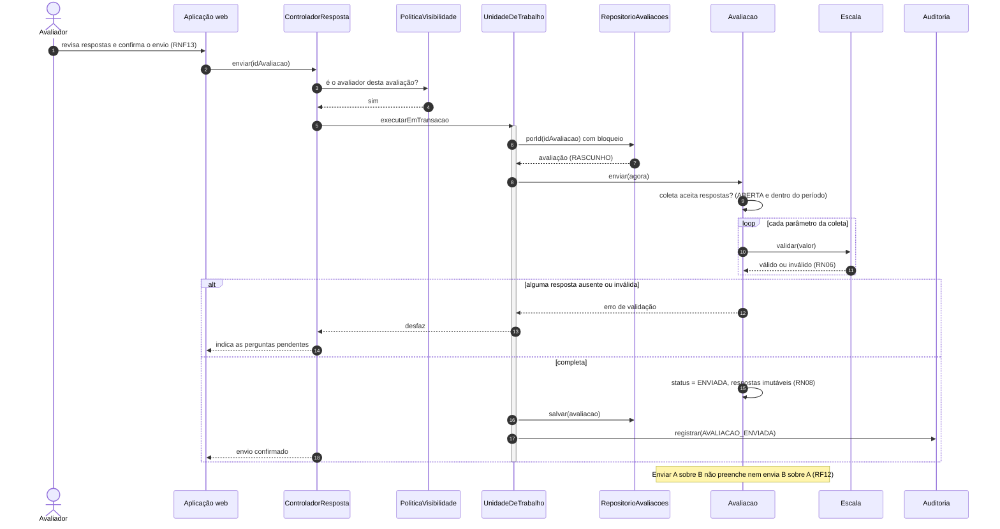
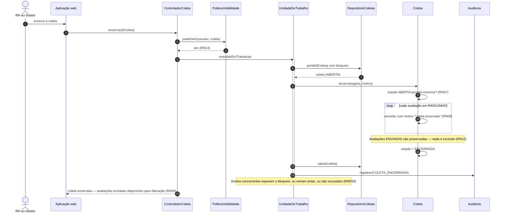
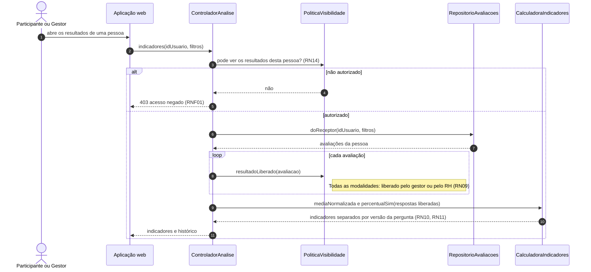
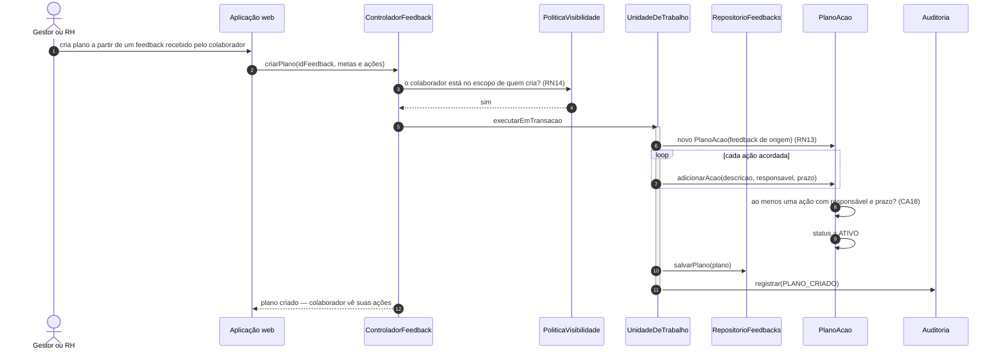
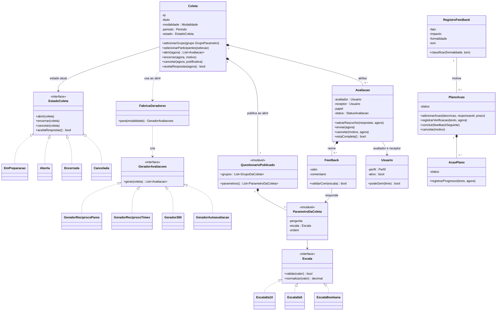
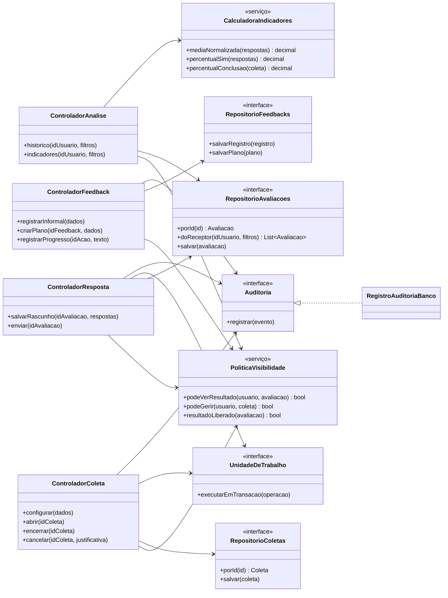

# Modelo de projeto (design)

Autoria: Luiz Augusto Vaz. Versão 0.1 — 21 de novembro de 2026. Situação: **proposta para revisão da equipe**.

Detalha como o sistema cumpre os requisitos por dentro, abaixo do nível 3 da [visão arquitetural C4](../arquitetura/README.md). Segue a sequência de Larman (*Utilizando UML e padrões*): contratos de operação → diagramas de interação → diagrama de classes de projeto, guiados pelos [padrões de projeto](padroes-de-projeto.md). Nenhuma linguagem foi escolhida (AD05): nomes e tipos são ilustrativos.

## 1. Artefatos

| Artefato | Arquivos | Responde |
| --- | --- | --- |
| [Diagramas de estado](#2-diagramas-de-estado) | `estado-*.mmd` | Em que estados vivem coleta, avaliação, plano e ação, e o que muda cada um? |
| [Contratos de operação](#3-contratos-de-operação) | Este README | O que cada operação crítica exige antes e garante depois? |
| [Diagramas de sequência](#4-diagramas-de-sequência) | `sequencia-*.mmd` | Quais objetos colaboram em cada fluxo principal e em que ordem? |
| [Diagrama de classes de projeto](#5-diagrama-de-classes-de-projeto) | `classes-*.mmd` | Quais classes, operações e dependências o sistema terá? |
| [Padrões de projeto](padroes-de-projeto.md) | `padroes-de-projeto.md` | Por que as responsabilidades foram divididas assim (PP01 a PP22)? |

Os diagramas estão em Mermaid: os `.mmd` são as fontes editáveis, e o mesmo conteúdo aparece nos blocos abaixo, que o GitHub desenha direto na página.

## 2. Diagramas de estado

### 2.1. Coleta

RN07, RF09, RF13 — CU-01, CU-03. Implementado com o padrão *State* (PP10). Fonte: [estado-coleta.mmd](estado-coleta.mmd).



### 2.2. Avaliação

RN08, RF11, RF12 — CU-02, CU-03. Fonte: [estado-avaliacao.mmd](estado-avaliacao.mmd).



### 2.3. Plano de ação e ação do plano

RF18, RN13 — CU-11. Os estados vêm do [dicionário de dados](../../dicionario-dados.md) (PLANO_ACAO e ACAO_PLANO). Fonte: [estado-plano-acao.mmd](estado-plano-acao.mmd).



## 3. Contratos de operação

Para as operações que mudam vários objetos de uma vez. Formato de Larman: pré-condições (o que precisa ser verdade antes) e pós-condições (o que passa a ser verdade depois, em termos de objetos criados, associações formadas e atributos alterados).

### CO01 — `abrir(idColeta)`

| Campo | Conteúdo |
| --- | --- |
| Caso de uso | CU-01 (e CU-09 para o 360°) |
| Referências | RF09, RF10, RF17, RF22, RN03, RN05, RN14, RN15, RNF02 |
| Pré-condições | Coleta em PREPARACAO; usuário é RH ou gestor com a coleta no seu escopo; há ao menos um grupo com parâmetro; período válido; seleção resulta em ao menos um par ou participante elegível. |
| Pós-condições | Foi criado um `QuestionarioPublicado` com cópia de grupos e parâmetros; os participantes foram congelados; foi criada uma `Avaliacao` em RASCUNHO para cada sentido, par ou papel, conforme a modalidade, sem duplicatas; a coleta passou a ABERTA; foi criado um evento de auditoria. Se qualquer passo falhar, nada disso existe. |

### CO02 — `enviar(idAvaliacao)`

| Campo | Conteúdo |
| --- | --- |
| Caso de uso | CU-02 |
| Referências | RF12, RN06, RN08, RNF02 |
| Pré-condições | Usuário é o avaliador; avaliação em RASCUNHO; coleta ABERTA e dentro do período; há exatamente uma resposta válida para cada parâmetro da coleta. |
| Pós-condições | A avaliação passou a ENVIADA, com `enviada_em` registrado; as respostas ficaram imutáveis; a avaliação do sentido oposto não foi alterada; foi criado um evento de auditoria. |

### CO03 — `encerrar(idColeta)`

| Campo | Conteúdo |
| --- | --- |
| Caso de uso | CU-03 |
| Referências | RF13, RN07, RN08, RN09, RN12, RNF02 |
| Pré-condições | Coleta ABERTA; usuário é RH ou gestor com a coleta no seu escopo. |
| Pós-condições | A coleta passou a ENCERRADA, com `encerrada_em` registrado; cada avaliação em RASCUNHO passou a CANCELADA com motivo; avaliações ENVIADAS foram preservadas; as avaliações enviadas ficaram disponíveis para o gestor ou o RH liberar (RN09); foi criado um evento de auditoria. |

### CO04 — `criarPlano(idFeedback, dados)`

| Campo | Conteúdo |
| --- | --- |
| Caso de uso | CU-11 |
| Referências | RF18, RN13, RN14, CA18 |
| Pré-condições | O feedback de origem existe e foi recebido por um colaborador no escopo de quem cria; há ao menos uma ação com responsável e prazo. |
| Pós-condições | Foi criado um `PlanoAcao` ATIVO associado ao feedback de origem; foram criadas as `AcaoPlano` em PENDENTE, cada uma associada ao responsável; foi criado um evento de auditoria. |

## 4. Diagramas de sequência

Fluxos principais dos casos de uso completos e do CU-11. Os fluxos alternativos estão descritos em cada [caso de uso](../../casos-de-uso/README.md).

### 4.1. Abrir coleta (CU-01)

Contrato CO01. Padrões: *Controller*, *Unit of Work*, *Factory Method*, *Creator*. Fonte: [sequencia-abrir-coleta.mmd](sequencia-abrir-coleta.mmd).



### 4.2. Enviar avaliação (CU-02)

Contrato CO02. Padrões: *Information Expert*, *Strategy*, bloqueio pessimista. Fonte: [sequencia-enviar-avaliacao.mmd](sequencia-enviar-avaliacao.mmd).



### 4.3. Encerrar coleta (CU-03)

Contrato CO03. Padrões: *State*, *Unit of Work*, bloqueio pessimista. Fonte: [sequencia-encerrar-coleta.mmd](sequencia-encerrar-coleta.mmd).



### 4.4. Consultar resultados (CU-04)

Padrões: *Policy*, *Pure Fabrication*, *Strategy*. Fonte: [sequencia-consultar-resultados.mmd](sequencia-consultar-resultados.mmd).



### 4.5. Criar plano de ação (CU-11)

Contrato CO04. Padrões: *Creator*, *Unit of Work*. Fonte: [sequencia-criar-plano-acao.mmd](sequencia-criar-plano-acao.mmd).



## 5. Diagrama de classes de projeto

O [modelo de domínio](../dominio/modelo-dominio.md) mostra conceitos; aqui as classes ganham operações, navegabilidade e as interfaces dos padrões. Atributos completos e tipos continuam no [dicionário de dados](../../dicionario-dados.md).

### 5.1. Camada de domínio

Fonte: [classes-dominio.mmd](classes-dominio.mmd).



### 5.2. Camada de aplicação e infraestrutura

Fonte: [classes-aplicacao.mmd](classes-aplicacao.mmd).



| Controlador | Componente C4 | Casos de uso | Operações |
| --- | --- | --- | --- |
| `ControladorColeta` | Coletas | CU-01, CU-03, CU-09 | `configurar`, `abrir` (CO01), `encerrar` (CO03), `cancelar` |
| `ControladorResposta` | Respostas | CU-02 | `salvarRascunho`, `enviar` (CO02) |
| `ControladorAnalise` | Análise e histórico | CU-04 | `historico`, `indicadores` |
| `ControladorFeedback` | Feedback e desenvolvimento | CU-10, CU-11 | `registrarInformal`, `criarPlano` (CO04), `registrarProgresso` |

Os componentes Organização (CU-06, CU-07), Catálogo (CU-05) e Autenticação (CU-08) seguem o mesmo formato — um controlador, um repositório e as regras no domínio — e não foram detalhados por serem cadastros sem regras de interação entre objetos.

## 6. Limites

- Os diagramas descrevem os fluxos principais. Os alternativos estão nos casos de uso e devem ser modelados se a disciplina pedir.
- CU-06 a CU-11 têm só descrição resumida; o CU-11 foi modelado aqui a partir do RF18, da RN13 e do CA18.
- A regra de liberação (PV04: pelo gestor ou pelo RH) e a identificação por modalidade (C02, RN-DOC-02) ficam isoladas na `PoliticaVisibilidade`.
- Nada aqui escolhe linguagem, framework ou banco específico.

## 7. Exportar imagens

A partir desta pasta, com o Node.js instalado:

```bash
for f in *.mmd; do npx -y -p @mermaid-js/mermaid-cli mmdc -i "$f" -o "exportacoes/${f%.mmd}.png" -b white -s 2; done
```
